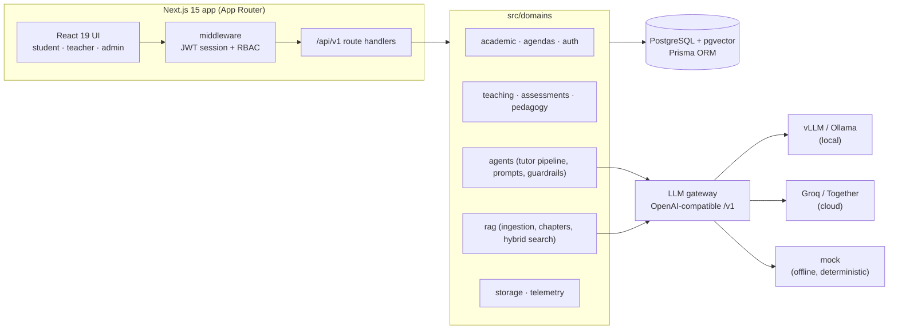

# Soberania AI

[Português](README.pt-BR.md) | **English**

An education platform with a Socratic AI tutor, retrieval-augmented generation (RAG) over the school's own textbooks, lesson planning, and chapter-based assessments.

## Why this exists

Schools that adopt cloud chatbots face three problems: student data leaves the institution (Brazil's LGPD privacy law), per-token pricing makes budgets unpredictable, and generic assistants hand out finished answers, which makes cheating easy.
Soberania AI is designed to run on open models hosted locally (vLLM or Ollama), so no inference traffic leaves the school network. The same code also runs against cloud providers (Groq, Together) through one OpenAI-compatible gateway.
The tutor is built to guide students, not answer for them. It cites the official course material, and it refuses to give out answers during exams.

## Status

- Solo project, in active development in 2026.
- No production pilot yet and no customers. It runs locally in demo mode with seeded data.
- The product vision (on-premises appliance, personas, KPIs) is in [docs/PRD.md](docs/PRD.md). Not every PRD item is implemented.

## Architecture

```mermaid
flowchart LR
  A["Upload<br/>PDF · DOCX · TXT · MD"] --> B["Validation<br/>extension, size, magic bytes"]
  B --> C["Text extraction<br/>pdf-parse · mammoth · OCR (tesseract.js)"]
  C --> D["Chapter tree<br/>PDF outline → AI + realignment → headings → manual"]
  D --> E["Chunks<br/>~450 chars, 60 overlap, sentence-aware,<br/>linked to a chapter node"]
  E --> F["Embeddings<br/>1024 dims (e.g. bge-m3)"]
  F --> G["Hybrid search in SQL<br/>pgvector HNSW + Portuguese full-text,<br/>fused with RRF, scoped to chapter subtree"]
  G --> H["Tutor prompt<br/>[FONTE: Book · Chapter, p. N] blocks"]
  H --> I["Streamed answer with citation"]
```





### Design decisions

**Domains instead of layers.** Business logic lives in `src/domains/<domain>` (services, repositories, pure functions). Route handlers stay thin: they parse input with Zod, check the role, and call a service. Most services take their dependencies as an argument (`deps`), so they are tested without a database.

**One OpenAI-compatible gateway.** `src/lib/ai-provider.ts` speaks `/v1/chat/completions` with streaming. Switching from a local vLLM to Groq is a change of `AI_PROVIDER`, `AI_BASE_URL` and `AI_MODEL`, not a code change. The gateway records time-to-first-token, tokens per second and token usage per call (`InferenceLog`). On HTTP 429 it retries once if the provider's suggested wait is short, then falls back to a deterministic stream and reports the reason.

**Chapter-based chunking.** Teachers plan lessons and exams by textbook chapter, so retrieval has to respect chapters. Each PDF gets a chapter tree (`MaterialChapter`, self-referencing `parentId`, N levels). Extraction tries the PDF outline first, then an LLM reading the table of contents (realigned to the real text and page labels), then heading detection, and finally manual editing. Every chunk points to a chapter node. A lesson or assessment linked to chapters restricts the search to that subtree (`src/domains/rag/services/chapter-scope.ts`).

**Citations.** The tutor pipeline (`src/domains/agents/tutor-pipeline.ts`) runs hybrid search and injects each retrieved chunk as `[FONTE: Book · Chapter, p. N]` in the system prompt. The prompt requires the model to cite in that format, and the API returns the top citation to the UI next to the answer.

**No ready-made answers in class.** Each session type has its own system prompt: classroom (Socratic questions, no direct answer), study group, office hours, draft review (rubric feedback, never rewrites the student's text) and exam. In exams, a deterministic guardrail checks the current message and every student turn in the history before any retrieval or model call, and returns a fixed refusal. Shared style rules (`TUTOR_STYLE_RULES`) keep answers short and plain-text. Separately, a small LLM judge grades the student's reply to a Socratic challenge; the result feeds the pedagogical minutes sent to the teacher.

## Stack

| Layer | Technology |
| :-- | :-- |
| Framework | Next.js 15 (App Router), React 19, TypeScript (strict) |
| UI | Tailwind CSS v4, shadcn/ui, Radix, Lucide |
| Data | PostgreSQL with pgvector, Prisma ORM 6, SQL migrations |
| Auth | JWT (jose, HS256) in httpOnly cookie, server-side sessions with revocation, role-based access (STUDENT, TEACHER, ADMIN) |
| AI | OpenAI-compatible gateway: mock, Ollama, vLLM, Groq, Together; SSE streaming |
| RAG | pgvector HNSW + Postgres full-text (GIN), Reciprocal Rank Fusion in SQL |
| Ingestion | pdf-parse, mammoth (DOCX), tesseract.js (optional OCR) |
| Storage | Local filesystem or Cloudflare R2 (S3 SDK) |
| Tools | Local MCP server exposing search, FAQ, interaction logging, minutes and ingestion tools |
| Validation / tests | Zod, Vitest, Testing Library |

## Engineering practices

Numbers measured on the current `main`:

- About 48,000 lines of TypeScript/TSX in `src/`.
- 160 test files, 1,300 passing tests (Vitest). End-to-end tests against a real Postgres live in `tests/e2e/` and run only when `DATABASE_URL_TEST` is set.
- `"strict": true` in TypeScript. `npm run test:ci` runs typecheck, lint, tests and production build.
- 23 SQL migrations in `prisma/migrations/`, including the pgvector and full-text columns.
- Spec → plan → test-first workflow: design specs in [docs/superpowers/specs/](docs/superpowers/specs/) and step-by-step implementation plans in [docs/superpowers/plans/](docs/superpowers/plans/).
- RBAC is a deny-by-default prefix matrix enforced in the middleware (`src/lib/auth/rbac.ts`), plus ownership checks in services (a teacher cannot overwrite chapter links used by another teacher's lessons without an admin override).

Example tests:

- `src/domains/rag/__tests__/chapters.test.ts`: chapter tree building, page alignment, relinking.
- `src/domains/rag/__tests__/livro-sintetico-regression.test.ts`: regression on a synthetic 174-page textbook fixture that mirrors the structure of a scanned book (table of contents, units, chapters) whose outline is useless.
- `src/domains/rag/__tests__/hybrid-search.test.ts` and `tests/e2e/hybrid-search.test.ts`: RRF fusion, unit and against Postgres.
- `src/domains/agents/__tests__/exam-guardrails.test.ts` and `tutor-pipeline.test.ts`: guardrail blocks before RAG and model calls.
- `src/lib/auth/__tests__/rbac.test.ts`: role matrix.
- `tests/e2e/full-flow.test.ts`: admin → teacher (upload, plan, lesson, exam) → student (chat, submission) → minutes and reports.

## Class events

The classroom is driven by an append-only `class_events` table (per-class `seq`, trigger `pg_notify`). Clients read it through `GET /api/v1/agendas/:id/events` (paged) and `GET /api/v1/agendas/:id/events/stream` (SSE with `retry: 1000`, `id: <seq>` and resume through `Last-Event-ID`); `POST` on the first route appends an event. The student page uses the `useClassEvents` hook and has no periodic `setInterval`: if the stream does not open within 10 s it falls back to polling every 5 s and retries the stream after 30 s.

- `CLASS_EVENTS_NOTIFY_MODE=poll` (default): each open connection queries the table every 2 s. Works with any Postgres, including poolers.
- `CLASS_EVENTS_NOTIFY_MODE=listen`: Postgres `LISTEN/NOTIFY`, one `pg.Client` per process. Needs a direct connection (no pooler).
- `CLASS_EVENTS_STREAM_MAX_MS`: maximum duration of one stream connection. Default 8000 when `VERCEL` is set, 0 (unlimited) elsewhere. When it ends the browser reconnects with `Last-Event-ID`, so nothing is lost or repeated; on Vercel expect about 2 s of latency.

To drive a class end to end in a browser (teacher panel and student page), run `npm run test:e2e:ui`. It needs the dev server (Playwright starts `npm run dev` or reuses port 3000), a `.env` pointing to the dev database, Chromium installed with `npx playwright install chromium`, and no seed beyond the demo accounts. CI does not run this test.

## Evals

[`evals/`](evals/README.md) is a Python 3.11 harness that tests the tutor's behavior over HTTP, the way a student uses it: it logs in with the demo account, asks 40 questions derived from the seed corpus and grades the replies.

- Five categories: grounded facts with the right chapter citation, answer-seeking during class (must stay Socratic), off-corpus questions (must refuse), style limits, and prompt injection.
- Deterministic graders covered by pytest, plus an optional LLM judge on the same OpenAI-compatible gateway (`temperature=0`, closed rubric, JSON verdict).
- Each run writes a Markdown and JSON report with per-category pass rates and exits non-zero below the threshold. Example: [`evals/reports/exemplo-2026-11-07.md`](evals/reports/exemplo-2026-11-07.md).

## Quick start

Requirements: Node.js 20+ and Docker (for Postgres with pgvector).

```bash
npm install
cp .env.example .env          # set DATABASE_URL and, for real AI, the AI_* variables

docker run -d --name soberania-pg -p 5432:5432 \
  -e POSTGRES_PASSWORD=postgres -e POSTGRES_DB=soberania_db pgvector/pgvector:pg17

npx prisma generate
npx prisma migrate deploy
npm run db:seed               # idempotent demo data
npm run dev                   # http://localhost:3000
```

Alternative: `docker compose up --build` starts Postgres and the app together (see `docker-compose.yml`).

### Demo users

Created by the seed. Set `NEXT_PUBLIC_DEMO_MODE=true` to show one-click login shortcuts. Never enable it in production.

| Role | Email | Password |
| :-- | :-- | :-- |
| ADMIN | `admin@soberania.edu.br` | admin123 |
| TEACHER | `professor@soberania.edu.br` | prof123 |
| STUDENT | `aluno@soberania.edu.br` | aluno123 |

For a real deployment, skip the seed, set a strong `AUTH_SECRET` (the server refuses weak secrets in production) and create the first admin:

```bash
npm run admin:create -- --email admin@school.edu --name "Admin Name" --password "strong-password"
```

### Environment

All variables are documented in [.env.example](.env.example). The essential ones:

| Variable | Purpose |
| :-- | :-- |
| `DATABASE_URL` | Postgres connection (pgvector required) |
| `AUTH_SECRET` | JWT signing secret, 32+ characters in production |
| `NEXT_PUBLIC_DEMO_MODE` | Shows demo login shortcuts |
| `AI_PROVIDER` | `mock` (default, offline), `ollama`, `vllm`, `groq` or `together` |
| `AI_BASE_URL`, `AI_API_KEY`, `AI_MODEL` | Inference endpoint, key and chat model |
| `AI_EMBEDDING_MODEL`, `AI_EMBEDDING_BASE_URL` | Embedding model (must output 1024 dimensions, e.g. `bge-m3`); empty means lexical search only |
| `ENABLE_OCR` | OCR for scanned PDFs |
| `STORAGE_PROVIDER` | `local` or `r2` |
| `CLASS_EVENTS_NOTIFY_MODE` | `poll` (default) or `listen` (needs a direct Postgres connection) |
| `CLASS_EVENTS_STREAM_MAX_MS` | Max duration of one event stream; default 8000 on Vercel, unlimited elsewhere |

**Groq note.** Recommended chat model: `openai/gpt-oss-120b`, with `AI_BASE_URL=https://api.groq.com/openai/v1`. Some free-tier models have a low tokens-per-minute limit and return 429 on long tutor prompts. Groq has no embeddings endpoint, so point `AI_EMBEDDING_BASE_URL` at an Ollama running `bge-m3`, or leave embeddings off.

## Roadmap

- Link library materials to subjects so the tutor searches only the course's own books.
- Persist exam answers during the exam, not only on submit.
- Record which embedding model produced each vector, and reindex automatically when it changes.
- Run a first pilot with a real school on local hardware (vLLM).

## Known limitations

- The tutor's Socratic behavior is enforced by prompts, not by code. Only the exam guardrail is deterministic, and it is keyword-based, so paraphrased cheating requests can get through to the model.
- RAG search filters by category, material and chapter, but not by subject yet: the subject parameter is ignored.
- When the provider fails, chat falls back to a deterministic offline stream. Lesson and assessment generation return 429 on rate limits, but plan-unit and chapter-distribution generation report rate limits as 503.
- Exam answers live only in browser memory until submission; reloading the page loses them.
- Chapter extraction is PDF-only. DOCX and TXT get synthetic "Trecho N" (excerpt N) citations.
- Two tests are known to be flaky: `src/app/api/v1/agent/chat/__tests__/route.test.ts` (classroom fallback case) and `MaterialChaptersPanel.test.tsx` (subtree removal case).
- The optional Python sandbox (MCP tool) is off by default and is not OS-isolated.

## Author

Ricardo Salles, Florianópolis, Brazil.
[linkedin.com/in/rffsalles](https://linkedin.com/in/rffsalles) · [github.com/rffsalles](https://github.com/rffsalles)

## License

All rights reserved. Source available for evaluation.
