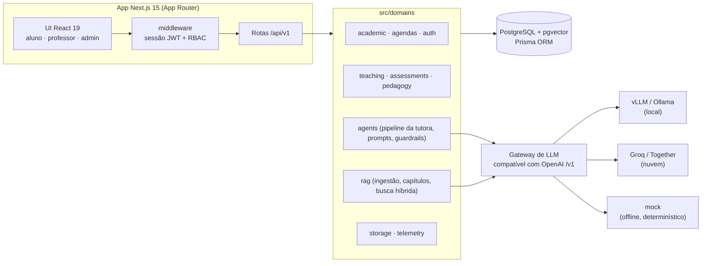
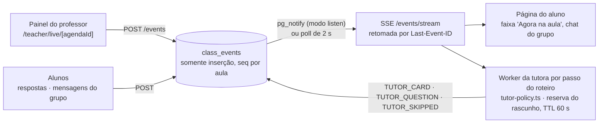

# Soberania AI

**Português** | [English](README.md)

Plataforma educacional com tutora socrática por IA, RAG (geração aumentada por recuperação) sobre os livros da própria escola, planejamento de aulas e avaliações por capítulo.

## Por que existe

Escolas que adotam chatbots em nuvem enfrentam três problemas: dados de alunos saem da instituição (LGPD), a cobrança por token torna o orçamento imprevisível e assistentes genéricos entregam a resposta pronta, o que facilita a cola.
O Soberania AI foi projetado para rodar com modelos abertos hospedados localmente (vLLM ou Ollama), sem tráfego de inferência para fora da rede da escola. O mesmo código também roda com provedores em nuvem (Groq, Together) por meio de um único gateway compatível com a API da OpenAI.
A tutora foi feita para guiar o aluno, não para responder por ele. Ela cita o material oficial do curso e se recusa a dar respostas durante provas.

## Status

- Projeto solo, em desenvolvimento ativo em 2026.
- Ainda sem piloto em produção e sem clientes. Roda localmente em modo demonstração, com dados de seed.
- A visão de produto (appliance on-premises, personas, KPIs) está em [docs/PRD.md](docs/PRD.md). Nem todo item do PRD está implementado.

## Arquitetura

```mermaid
flowchart LR
  A["Upload<br/>PDF · DOCX · TXT · MD"] --> B["Validação<br/>extensão, tamanho, magic bytes"]
  B --> C["Extração de texto<br/>pdf-parse · mammoth · OCR (tesseract.js)"]
  C --> D["Árvore de capítulos<br/>outline do PDF → IA + realinhamento → títulos → manual"]
  D --> E["Chunks<br/>~450 caracteres, 60 de sobreposição, respeita frases,<br/>ligados a um nó de capítulo"]
  E --> F["Embeddings<br/>1024 dimensões (ex.: bge-m3)"]
  F --> G["Busca híbrida em SQL<br/>pgvector HNSW + texto completo em português,<br/>fusão por RRF, restrita à subárvore do capítulo"]
  G --> H["Prompt da tutora<br/>blocos [FONTE: Livro · Capítulo, pág. N]"]
  H --> I["Resposta em streaming com citação"]
```





### Decisões de projeto

**Domínios em vez de camadas.** A regra de negócio fica em `src/domains/<domínio>` (services, repositórios, funções puras). As rotas são finas: validam a entrada com Zod, conferem o papel e chamam um service. A maioria dos services recebe as dependências por argumento (`deps`), então é testada sem banco.

**Um único gateway compatível com OpenAI.** `src/lib/ai-provider.ts` fala `/v1/chat/completions` com streaming. Trocar um vLLM local pelo Groq é mudar `AI_PROVIDER`, `AI_BASE_URL` e `AI_MODEL`, não o código. O gateway registra tempo até o primeiro token, tokens por segundo e uso de tokens por chamada (`InferenceLog`). Em HTTP 429 ele repete uma vez se a espera sugerida pelo provedor for curta; depois cai num stream determinístico e informa o motivo.

**Chunking por capítulo.** Professores planejam aulas e provas por capítulo do livro, então a busca precisa respeitar capítulos. Cada PDF ganha uma árvore de capítulos (`MaterialChapter`, `parentId` autorreferente, N níveis). A extração tenta primeiro o outline do PDF, depois um LLM lendo o sumário (realinhado ao texto real e aos rótulos de página), depois a detecção de títulos e, por fim, a edição manual. Cada chunk aponta para um nó de capítulo. Uma aula ou avaliação ligada a capítulos restringe a busca àquela subárvore (`src/domains/rag/services/chapter-scope.ts`).

**Citações.** O pipeline da tutora (`src/domains/agents/tutor-pipeline.ts`) roda a busca híbrida e injeta cada chunk recuperado como `[FONTE: Livro · Capítulo, pág. N]` no prompt de sistema. O prompt exige que o modelo cite nesse formato, e a API devolve à interface a citação principal junto com a resposta.

**Sem resposta pronta em sala de aula.** Cada tipo de sessão tem seu prompt de sistema: sala de aula (perguntas socráticas, sem resposta direta), grupo de estudos, plantão de dúvidas, revisão de rascunho (feedback por rubrica, nunca reescreve o texto do aluno) e prova. Na prova, um guardrail determinístico verifica a mensagem atual e todo turno do aluno no histórico antes de qualquer busca ou chamada ao modelo, e devolve uma recusa fixa. Regras de estilo compartilhadas (`TUTOR_STYLE_RULES`) mantêm as respostas curtas e em texto puro. À parte, um pequeno juiz LLM avalia a resposta do aluno a um desafio socrático; o resultado alimenta as atas pedagógicas enviadas ao professor.

## Stack

| Camada | Tecnologia |
| :-- | :-- |
| Framework | Next.js 15 (App Router), React 19, TypeScript (strict) |
| UI | Tailwind CSS v4, shadcn/ui, Radix, Lucide |
| Dados | PostgreSQL com pgvector, Prisma ORM 6, migrações SQL |
| Autenticação | JWT (jose, HS256) em cookie httpOnly, sessões no servidor com revogação, acesso por papel (STUDENT, TEACHER, ADMIN) |
| IA | Gateway compatível com OpenAI: mock, Ollama, vLLM, Groq, Together; streaming SSE |
| RAG | pgvector HNSW + texto completo do Postgres (GIN), Reciprocal Rank Fusion em SQL |
| Ingestão | pdf-parse, mammoth (DOCX), tesseract.js (OCR opcional) |
| Armazenamento | Sistema de arquivos local ou Cloudflare R2 (S3 SDK) |
| Ferramentas | Servidor MCP local com ferramentas de busca, FAQ, registro de interações, atas e ingestão |
| Validação / testes | Zod, Vitest, Testing Library |

## Práticas de engenharia

Números medidos no `main` atual:

- Cerca de 60.000 linhas de TypeScript/TSX em `src/` (testes incluídos).
- 214 arquivos de teste (210 rodam por padrão; 4 de ponta a ponta exigem `DATABASE_URL_TEST`), 1.894 testes passando (Vitest). Testes ponta a ponta contra um Postgres real ficam em `tests/e2e/`. 3 testes Playwright em `tests/playwright/` conduzem uma aula (painel do professor, página do aluno, grupo de estudo com dois alunos); o CI não os roda.
- `"strict": true` no TypeScript. `npm run test:ci` roda typecheck, lint, testes e build de produção.
- 25 migrações SQL em `prisma/migrations/`, incluindo as colunas de pgvector e texto completo.
- Fluxo spec → plano → teste primeiro: specs de design em [docs/superpowers/specs/](docs/superpowers/specs/) e planos de implementação passo a passo em [docs/superpowers/plans/](docs/superpowers/plans/).
- RBAC é uma matriz de prefixos com negação por padrão, aplicada no middleware (`src/lib/auth/rbac.ts`), além de checagens de propriedade nos services (um professor não sobrescreve vínculos de capítulo usados nas aulas de outro professor sem a intervenção de um admin).

Testes de exemplo:

- `src/domains/rag/__tests__/chapters.test.ts`: montagem da árvore de capítulos, alinhamento de páginas, revinculação.
- `src/domains/rag/__tests__/livro-sintetico-regression.test.ts`: regressão sobre um fixture sintético de 174 páginas que reproduz a estrutura de um livro escaneado (sumário, unidades, capítulos) cujo outline é inútil.
- `src/domains/rag/__tests__/hybrid-search.test.ts` e `tests/e2e/hybrid-search.test.ts`: fusão RRF, unitário e contra Postgres.
- `src/domains/agents/__tests__/exam-guardrails.test.ts` e `tutor-pipeline.test.ts`: o guardrail bloqueia antes da busca e da chamada ao modelo.
- `src/lib/auth/__tests__/rbac.test.ts`: matriz de papéis.
- `tests/e2e/full-flow.test.ts`: admin → professor (upload, plano, aula, prova) → aluno (chat, envio) → atas e relatórios.

## Eventos de aula

A sala de aula é movida por uma tabela `class_events` somente de inserção (`seq` por aula, trigger `pg_notify`). Os clientes leem por `GET /api/v1/agendas/:id/events` (paginado) e `GET /api/v1/agendas/:id/events/stream` (SSE com `retry: 1000`, `id: <seq>` e retomada por `Last-Event-ID`); o `POST` na primeira rota grava um evento. A página do aluno usa o hook `useClassEvents` e não tem `setInterval` periódico: se o stream não abrir em 10 s, cai para polling a cada 5 s e tenta o stream de novo após 30 s.



- `CLASS_EVENTS_NOTIFY_MODE=poll` (padrão): cada conexão aberta consulta a tabela a cada 2 s. Funciona com qualquer Postgres, inclusive com pooler.
- `CLASS_EVENTS_NOTIFY_MODE=listen`: `LISTEN/NOTIFY` do Postgres, um `pg.Client` por processo. Exige conexão direta (sem pooler).
- `CLASS_EVENTS_STREAM_MAX_MS`: duração máxima de uma conexão de stream. Padrão 8000 com `VERCEL` definido, 0 (sem limite) fora. Ao terminar, o navegador reconecta com `Last-Event-ID`, sem perder nem repetir eventos; na Vercel a latência fica em cerca de 2 s.

Para conduzir uma aula de ponta a ponta no navegador (painel do professor e página do aluno), rode `npm run test:e2e:ui`. Precisa do servidor de dev (o Playwright sobe `npm run dev` ou reaproveita a porta 3000), de um `.env` apontando para o banco de dev, do Chromium instalado com `npx playwright install chromium` e do seed de demonstração (contas e a agenda "Modelagem Conceitual e Álgebra Relacional (JOINs)"); o próprio teste define o roteiro e reabre a agenda. Com `PLAYWRIGHT_BASE_URL` definido, o navegador acessa esse servidor, mas o Prisma continua gravando no banco do `.env` local; use só quando os dois apontam para o mesmo ambiente. O CI não roda este teste.

A tutora proativa trabalha por passo do roteiro da aula. Ela publica um cartão citado (capítulo e página) e, quando cabe, uma pergunta de verificação de múltipla escolha montada a partir dos capítulos da aula; as respostas dos alunos e um pulso da turma voltam como eventos. A política de silêncio é explícita (`src/domains/classroom/tutor-policy.ts`): quando não fala, registra um evento `TUTOR_SKIPPED` com o motivo (`NO_MATERIAL`, `RATE_LIMIT`, `BUDGET`, `PROVIDER_ERROR`). Um passo custa no máximo 2 chamadas ao modelo, e workers concorrentes são separados por uma reserva no banco com TTL de 60 s em `tutor_step_drafts`. O professor pode pré-gerar todos os passos no editor de aula ("Preparar tutora"); um passo preparado é publicado sem chamar o modelo, e aulas gravadas usam passos com tempo de vídeo. Sem embeddings, a busca é só léxica e sempre devolve algo que casa uma palavra, então `src/domains/classroom/lexical-relevance.ts` exige que os termos do tópico do passo sejam cobertos pelo trecho; do contrário a tutora fica em silêncio com `NO_MATERIAL`. O Playwright cobre isso sem provedor real: cada execução começa com a tutora em silêncio na aula toda, libera só o passo testado com um rascunho preparado e confere que nenhuma linha `TUTOR_CARD`/`TUTOR_QUESTION` foi registrada em `inference_logs`.

O grupo de estudo usa o mesmo log: as mensagens são eventos `GROUP_MESSAGE` e o hook do cliente não faz polling. A intervenção da tutora após um período de silêncio não guarda estado em memória: `claimStalemate` reserva a tentativa no banco sob a trava da agenda (um vencedor por janela, e só se a última mensagem ainda é a esperada) e os demais veem um evento `STALEMATE_CLAIMED`.

## Evals

[`evals/`](evals/README.md) é um harness em Python 3.11 que testa o comportamento da tutora pela API HTTP, como um aluno a usa: faz login com a conta de demonstração, envia 40 perguntas derivadas do seed e avalia as respostas.

- Cinco categorias (40 casos): fatos do material com citação do capítulo certo (10), pedido de resposta pronta em aula (8, deve seguir socrática), assuntos fora do acervo (8, deve recusar), limites de estilo (6) e injeção de prompt (8).
- Graders determinísticos cobertos por pytest e um juiz LLM opcional no mesmo gateway compatível com OpenAI (`temperature=0`, rubrica fechada, veredito em JSON).
- Cada execução gera relatório Markdown e JSON com a taxa por categoria e sai com código diferente de zero abaixo do limiar. Última rodada completa, com a tutora e o juiz `openai/gpt-oss-120b` na Groq: 40/40 (100%) com busca híbrida (embeddings bge-m3) em 2026-11-09; na busca léxica, 38/40 (95%), contra 29/40 antes das correções que ela motivou, e as falhas restantes estão analisadas em [`evals/reports/depois-2026-11-07.md`](evals/reports/depois-2026-11-07.md) (linha de base: [`exemplo-2026-11-07.md`](evals/reports/exemplo-2026-11-07.md)). As duas rodadas não são exatamente comparáveis, porque a de 38/40 usou juiz LLM.
- Uma sexta categoria opcional, `proativo` (10 casos, exige provedor real), entra como professor, avança a aula ao vivo do seed passo a passo e avalia os cartões e perguntas proativos. Fez 10/10 em 2026-11-09 (3 rodadas). Ela consome a aula demo; `node evals/reset-demo.cjs` zera só os eventos e rascunhos dessa agenda em banco local, sem refazer o seed.

## Início rápido

Requisitos: Node.js 20+ e Docker (para o Postgres com pgvector).

```bash
npm install
cp .env.example .env          # ajuste DATABASE_URL e, para IA real, as variáveis AI_*

docker run -d --name soberania-pg -p 5432:5432 \
  -e POSTGRES_PASSWORD=postgres -e POSTGRES_DB=soberania_db pgvector/pgvector:pg17

npx prisma generate
npx prisma migrate deploy
npm run db:seed               # dados de demonstração (idempotente)
npm run dev                   # http://localhost:3000
```

Alternativa: `docker compose up --build` sobe Postgres e a aplicação juntos (veja `docker-compose.yml`).

### Usuários de demonstração

Criados pelo seed. Defina `NEXT_PUBLIC_DEMO_MODE=true` para exibir atalhos de login com um clique. Nunca habilite em produção.

| Papel | E-mail | Senha |
| :-- | :-- | :-- |
| ADMIN | `admin@soberania.edu.br` | admin123 |
| TEACHER | `professor@soberania.edu.br` | prof123 |
| STUDENT | `aluno@soberania.edu.br` | aluno123 |

Num ambiente real, não rode o seed, defina um `AUTH_SECRET` forte (o servidor recusa segredos fracos em produção) e crie o primeiro administrador:

```bash
npm run admin:create -- --email admin@escola.edu.br --name "Nome do Admin" --password "senha-forte"
```

### Variáveis de ambiente

Todas estão documentadas em [.env.example](.env.example). As essenciais:

| Variável | Função |
| :-- | :-- |
| `DATABASE_URL` | Conexão com o Postgres (pgvector obrigatório) |
| `AUTH_SECRET` | Segredo de assinatura do JWT, 32+ caracteres em produção |
| `NEXT_PUBLIC_DEMO_MODE` | Exibe os atalhos de login de demonstração |
| `AI_PROVIDER` | `mock` (padrão, offline), `ollama`, `vllm`, `groq` ou `together` |
| `AI_BASE_URL`, `AI_API_KEY`, `AI_MODEL` | Endpoint de inferência, chave e modelo de chat |
| `AI_EMBEDDING_MODEL`, `AI_EMBEDDING_BASE_URL` | Modelo de embeddings (precisa gerar 1024 dimensões, ex.: `bge-m3`); vazio significa só busca léxica |
| `ENABLE_OCR` | OCR para PDFs escaneados |
| `STORAGE_PROVIDER` | `local` ou `r2` |
| `CLASS_EVENTS_NOTIFY_MODE` | `poll` (padrão) ou `listen` (exige conexão direta ao Postgres) |
| `CLASS_EVENTS_STREAM_MAX_MS` | Duração máxima de um stream de eventos; padrão 8000 na Vercel, sem limite fora |

**Nota sobre o Groq.** Modelo de chat recomendado: `openai/gpt-oss-120b`, com `AI_BASE_URL=https://api.groq.com/openai/v1`. Alguns modelos do plano gratuito têm limite baixo de tokens por minuto e devolvem 429 em prompts longos da tutora. O Groq não tem endpoint de embeddings: aponte `AI_EMBEDDING_BASE_URL` para um Ollama rodando `bge-m3` ou deixe os embeddings desligados.

## Roadmap

- Vincular materiais do acervo a disciplinas, para a tutora buscar só nos livros do curso.
- Persistir as respostas da prova durante a prova, não só no envio.
- Registrar qual modelo gerou cada vetor e reindexar automaticamente quando ele mudar.
- Fazer um primeiro piloto com uma escola real em hardware local (vLLM).

## Limitações conhecidas

- O comportamento socrático em aula é imposto principalmente por prompt. As partes determinísticas: um detector por regex de pedido de resposta (`answer-request.ts`), um guarda de citação que remove referências a capítulo/página ausentes dos trechos recuperados e um curto-circuito de "sem material". O guardrail de prova usa palavras-chave, então pedidos de cola parafraseados podem chegar ao modelo.
- A recuperação pega só os 2 melhores trechos no chat (3 na tutora proativa) e não tem etapa de reranking.
- `TUTOR_MIN_SIMILARITY=0.55` foi medido com embeddings reais (bge-m3 via Ollama, em 2026-11-09): a similaridade não separa passos com material dos sem (válidos 0,50–0,70; inválido 0,62), então o corte só funciona como piso para trechos sem relação e ficou em 0,55. O que decide o tópico é a cobertura de termos do título do passo (≥ 50%, radical de 6 letras), aplicada nos modos léxico e híbrido. Limitação: um título de passo genérico, sem termos no trecho, pode cair em `NO_MATERIAL` mesmo com um trecho relevante.
- Os evals `proativo` dependem do acervo e da aula do seed; fizeram 10/10 nos modos léxico e híbrido (bge-m3), com a tutora e o juiz na Groq.
- A busca do RAG filtra por categoria, material e capítulo, mas ainda não por disciplina: o parâmetro de disciplina é ignorado.
- Quando o provedor falha, o chat cai num stream determinístico offline. A geração de aulas e de avaliações devolve 429 em limite de uso, mas a geração de unidades do plano e a distribuição de capítulos informam limite de uso como 503.
- As respostas da prova ficam só na memória do navegador até o envio; recarregar a página as perde.
- A extração de capítulos é só para PDF. DOCX e TXT recebem citações sintéticas "Trecho N".
- Dois testes são instáveis conhecidos: `src/app/api/v1/agent/chat/__tests__/route.test.ts` (caso de fallback da sala de aula) e `MaterialChaptersPanel.test.tsx` (caso de remoção de subárvore).
- O sandbox Python opcional (ferramenta MCP) vem desligado e não tem isolamento em nível de sistema operacional.

## Autor

Ricardo Salles, Florianópolis, Brasil.
[linkedin.com/in/rffsalles](https://linkedin.com/in/rffsalles) · [github.com/rffsalles](https://github.com/rffsalles)

## Licença

Todos os direitos reservados. Código disponível para avaliação.
