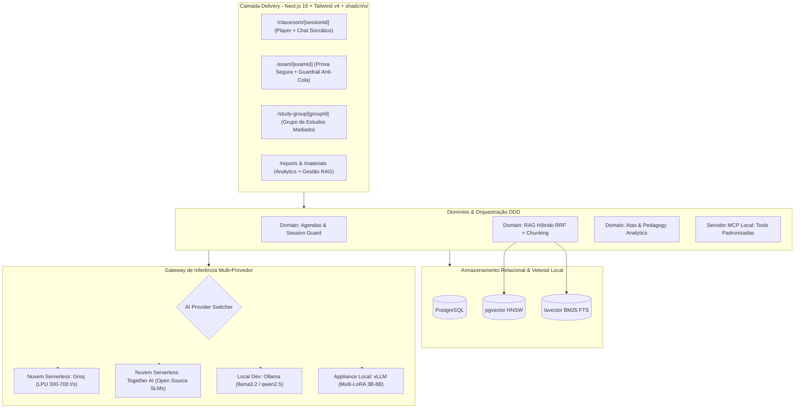

# 📋 PLAN: Implementação do Core (Fases 1 & 2) — Soberania AI

> **Documento:** Plano de Engenharia e Arquitetura de Fases 1 & 2  
> **Status:** 🟡 Proposto para Aprovação  
> **Responsáveis Principais:** `@[project-planner]`, `@[backend-specialist]`, `@[frontend-specialist]` e `@[devops-engineer]`  
> **Referências Normativas:** [`docs/PRD.md`](file:///c:/projects/soberania-ai/docs/PRD.md) · [`docs/UX_UI_DESIGN_SYSTEM.md`](file:///c:/projects/soberania-ai/docs/UX_UI_DESIGN_SYSTEM.md) · [`docs/rules/CLEAN_CODE.md`](file:///c:/projects/soberania-ai/docs/rules/CLEAN_CODE.md)  
> **Design System de Referência:** Identidade e paleta inspiradas no ecossistema [Prof. Luci](https://www.prof-lu.com.br/) (Teal `#0D9488`, Warm Orange `#F97316`, superfícies Ink `#0F172A`)

---

## 1. 🎯 Visão Executiva das Fases 1 e 2

O objetivo deste plano é materializar o núcleo funcional do **Soberania AI** conforme definido no Roadmap oficial do [PRD (Seção 8)](file:///c:/projects/soberania-ai/docs/PRD.md#L195-L205). O foco é entregar uma experiência educacional ponta a ponta onde:

1. **Fase 1 (RAG Híbrido, Bibliografia Institucional & Motor SLM Multi-Provedor):**
   - O Agente Professor consulta documentos oficiais (livros didáticos e artigos científicos em PDF) via **Busca Híbrida RRF (Reciprocal Rank Fusion)** no PostgreSQL (`pgvector` + `tsvector` BM25).
   - O motor de inferência opera através de uma interface padronizada OpenAI-compatible, permitindo rodar em **Nuvem Serverless para desenvolvimento (Groq / Together AI)**, em **Ollama Local** (para testes offline sem custos) e no **vLLM do Appliance On-Premises** (para produção e homologação final).
   - Toda resposta conceitual cita estritamente `[Livro X, Capítulo Y, pág. Z]`, eliminando alucinações.

2. **Fase 2 (Sala de Aula Interativa, Multi-Agendas, Atas Pedagógicas & Painel Docente):**
   - **Player Sincronizado** de aula com pausas socráticas e FAQ contextual em timestamps programados.
   - **As 5 Multi-Agendas Especializadas** ativas (Aula Síncrona, Prova Segura com Guardrail Anti-Cola, Grupo de Estudos com Mediação, Plantão de Dúvidas e Orientação de Trabalhos).
   - **Geração Automática de Atas Pedagógicas (Minutes)** ao término de cada sessão, medindo pontuação de engajamento, dúvidas frequentes e nível de hesitação.
   - **Painel do Professor Titular** para acompanhamento analítico do rendimento das turmas e gestão de materiais RAG.

---

## 2. 🏛️ Arquitetura Técnica & Decisões de Engenharia



### 2.1 Padrão de Inferência Agmóstica (AI Provider Gateway)
Para atender à necessidade de testes ágeis sem exigir compra imediata de GPU cara:
- A camada de inferência consumirá o endpoint padronizado `POST /v1/chat/completions` (OpenAI format).
- Variáveis de ambiente no `.env`:
  ```env
  AI_PROVIDER="groq" # "groq" | "together" | "ollama" | "vllm"
  AI_BASE_URL="https://api.groq.com/openai/v1"
  AI_API_KEY="gsk_..."
  AI_MODEL="llama-3.2-3b-preview"
  ```
- O código da aplicação permanece **100% idêntico** ao alternar entre Nuvem e Appliance On-Premises.

### 2.2 RAG Híbrido com Reciprocal Rank Fusion (RRF)
- **Extração & Parser:** Processador de PDFs didáticos preservando hierarquia de seções e número de página.
- **Embeddings:** FastEmbed local em CPU (`bge-m3` ou `multilingual-e5`) ou embedding serverless compatível para dev.
- **Fusão RRF:**
  $$RRF\_Score = \frac{1}{60 + Rank_{vector}} + \frac{1}{60 + Rank_{BM25}}$$
- **Garantia Pedagógica:** Resposta do SLM só é liberada com blocos de citação bibliográfica validados.

---

## 3. 🧩 Detalhamento das Fases & Tarefas

### 🔹 FASE 1: RAG Híbrido, Ingestão de Bibliografia & Motor SLM

| ID | Módulo / Tarefa | Descrição Técnica | Agente Responsável | Artefatos Criados / Alterados |
| :--- | :--- | :--- | :--- | :--- |
| **T1.1** | **AI Provider Client Unificado** | Refatorar `src/lib/vllm-client.ts` para um `AIProviderClient` genérico compatível com OpenAI SDK, suportando streaming SSE, telemetria real (TTFT, tokens/s) e alternância via `.env` (Groq, Together, Ollama, vLLM). | `@[backend-specialist]` | `src/lib/ai-provider.ts`, `src/lib/vllm-client.ts` |
| **T1.2** | **Extensão do Schema Prisma (pgvector & FTS)** | Atualizar o schema com campos de vetor e preparar a migração física obrigatória em `prisma/migrations/` para suportar busca vetorial HNSW e `tsvector` para busca léxica. | `@[database-architect]` | `prisma/schema.prisma`, `prisma/migrations/*` |
| **T1.3** | **Serviço de Ingestão de PDFs e Artigos** | Criar módulo de ingestão e chunking semântico em `src/domains/rag/ingestion.ts` com parser de PDF, extração de metadados (autor, título, capítulo, página) e geração de embeddings. | `@[backend-specialist]` | `src/domains/rag/ingestion.ts`, `src/domains/rag/types.ts` |
| **T1.4** | **Motor de Busca Híbrida RRF Real** | Integrar `src/domains/rag/hybrid-search.ts` ao banco de dados com a query de Reciprocal Rank Fusion combinando cosine distance (`<=>`) e `ts_rank_cd`. | `@[backend-specialist]` | `src/domains/rag/hybrid-search.ts`, `src/domains/rag/__tests__/` |
| **T1.5** | **Servidor MCP Tools Embutido** | Implementar as tools padronizadas do PRD: `search_didactic_material`, `get_lesson_faqs`, `register_student_interaction`, `generate_class_minutes`. | `@[backend-specialist]` | `src/lib/mcp/tools.ts`, `src/lib/mcp/server.ts` |
| **T1.6** | **Prompts Especializados & Guardrails Anti-Cola** | Desenvolver os system prompts pedagógicos socráticos por papel de agenda e o interceptor de guardrails contra pedidos diretos de gabarito e jailbreaks. | `@[backend-specialist]` | `src/domains/agents/prompts.ts`, `src/domains/agents/guardrails.ts` |

---

### 🔹 FASE 2: Sala de Aula Interativa, Multi-Agendas, Atas & Painel Docente

| ID | Módulo / Tarefa | Descrição Técnica | Agente Responsável | Artefatos Criados / Alterados |
| :--- | :--- | :--- | :--- | :--- |
| **T2.1** | **Player Interativo com Checkpoints Socráticos** | Aperfeiçoar o player de vídeo (`src/components/classroom/`) sincronizado com timestamps do currículo, disparando pausas proativas do Agente Professor e FAQ contextualizado. | `@[frontend-specialist]` | `src/components/classroom/VideoPlayer.tsx`, `src/components/classroom/CheckpointCard.tsx` |
| **T2.2** | **Chat Pedagógico com Streaming SSE & Citações RAG** | Implementar interface de chat fluida com tokens por SSE, badges de citação bibliográfica clicáveis (`[Livro, pág. X]`) e destaques socráticos com tokens do design system (`brand-teal`, `brand-orange`). | `@[frontend-specialist]` | `src/components/classroom/ChatStream.tsx`, `src/components/ui/citation-badge.tsx` |
| **T2.3** | **Sala de Prova Supervisionada & Guardrail Ativo** | Construir o fluxo de `/exam/[examId]` com cronômetro regressivo, bloqueio de cópia e detecção de tentativas de cola em tempo real conectada aos guardrails. | `@[frontend-specialist]` | `src/app/(student)/exam/[examId]/page.tsx`, `src/components/exam/*` |
| **T2.4** | **Grupo de Estudos Mediado por IA** | Desenvolver ambiente colaborativo `/study-group/[groupId]` onde o professor intervém socráticamente por solicitação ou impasse de debate. | `@[frontend-specialist]` | `src/app/(student)/study-group/[groupId]/page.tsx` |
| **T2.5** | **Motor de Atas Pedagógicas Automáticas (Minutes)** | Implementar o gerador de atas em `src/domains/pedagogy/minutes-generator.ts`, calculando scores de engajamento, tópicos dominados/vulneráveis e gerando pareceres acionáveis. | `@[backend-specialist]` | `src/domains/pedagogy/minutes-generator.ts`, `src/components/classroom/MinutesViewer.tsx` |
| **T2.6** | **Painel do Professor Titular & Gestão RAG** | Desenvolver dashboards em `/reports` (analytics de atas por turma) e `/materials` (upload de livros/artigos com barra de progresso de indexação RAG e simulador de busca). | `@[frontend-specialist]` | `src/app/(teacher)/reports/page.tsx`, `src/app/(teacher)/materials/page.tsx` |
| **T2.7** | **Telemetria de Appliance & Zero-Egress Visualizer** | Integrar widget e página `/appliance` com telemetria de TTFT, tokens/segundo, status do pgvector e confirmação de soberania de dados. | `@[frontend-specialist]` | `src/app/(admin)/appliance/page.tsx`, `src/components/layout/TelemetryBadge.tsx` |

---

## 4. 🎨 Diretrizes Visuais & Design System ([`docs/UX_UI_DESIGN_SYSTEM.md`](file:///c:/projects/soberania-ai/docs/UX_UI_DESIGN_SYSTEM.md))

Toda a implementação das Fases 1 & 2 deve respeitar rigorosamente:
1. **Paleta Prof. Luci:**
   - Primária: `brand-teal` (`#0D9488` / `hsl(175, 84%, 32%)`)
   - Destaque/Ação: `brand-orange` (`#F97316` / `hsl(25, 95%, 53%)`)
   - Superfícies Dark: `brand-ink` (`#0F172A` / `hsl(222, 47%, 11%)`)
   - Fundo Geral Light: `brand-canvas` (`#F8FAFC`)
2. **Tipografia:**
   - Títulos, slogans e botões de destaque: **Poppins** (`font-display font-semibold`)
   - Textos densos, mensagens do chat, atas e relatórios: **Inter** (`font-sans`)
3. **Citações RAG:**
   - Sempre em badge estilizado `bg-sky-50 dark:bg-sky-950/40 text-sky-700 dark:text-sky-300 border-sky-200 dark:border-sky-800` com ícone `BookOpen` do `lucide-react`.
4. **Sem Emojis em Ícones:**
   - Uso obrigatório e exclusivo de componentes da biblioteca `lucide-react`.
5. **Precisão Numérica:**
   - Uso de `CurrencyMath` para scores, percentuais e cálculos de retenção conforme convenção do projeto.

---

## 5. 🛡️ Critérios de Aceite & Checklist de Verificação

- [ ] **Inferência Funcional:** Chamada de chat socrático funcionando em streaming SSE via Groq/Together ou Ollama local com TTFT < 1.2s.
- [ ] **Fidelidade à Bibliografia:** Respostas técnicas citam livro, capítulo e página extraídos do acervo PDF cadastrado.
- [ ] **Bloqueio de Cola:** Aluno perguntando diretamente o gabarito de questão recebe resposta socrática orientadora e o incidente é gravado na ata.
- [ ] **Geração de Ata:** Ao completar uma aula, uma ata com score de engajamento e tópicos aprendidos é persistida no banco e renderizada no modal.
- [ ] **Zero Violações de Tipos e Linter:** Execução limpa de `tsc --noEmit` e `npm run lint`.
- [ ] **Migrações Físicas do Prisma:** Nenhuma alteração no `schema.prisma` sem a respectiva pasta física gerada em `prisma/migrations/`.
- [ ] **Testes Automatizados:** Testes unitários com Vitest cobrindo o parser RRF, cálculo de atas pedagógicas e guardrails de prompt.

---

## 6. 🚀 Próxima Etapa Recomendada

Após a aprovação deste plano pelo usuário, iniciaremos a execução através do comando `/create` ou execução ordenada das tarefas da **Fase 1 (Tarefas T1.1 a T1.6)**, configurando o gateway multi-provedor e o pipeline de RAG híbrido.
