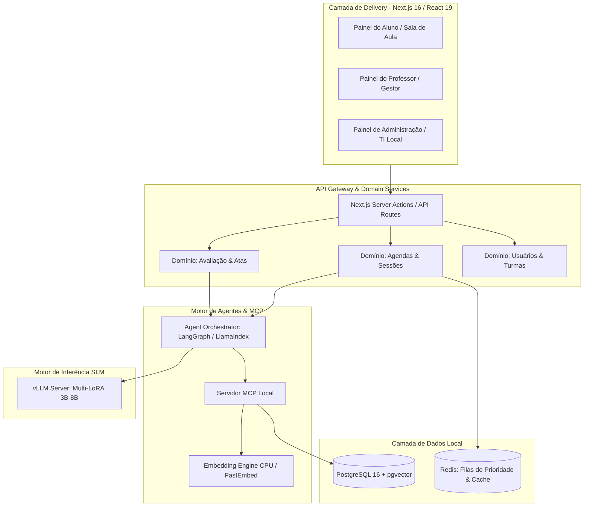

# 📋 Plano de Projeto: Soberania AI - Appliance Educacional On-Premises

> **Status:** 🟡 Proposta Inicial / Planejamento  
> **Versão:** 1.0.0  
> **Arquitetura Base:** Next.js 16 (App Router) + Fastify/Python MCP Server + PostgreSQL com pgvector + vLLM Multi-SLM

---

## 🎯 1. Visão Geral e Objetivos do Produto

O **Soberania AI** é uma plataforma educacional proprietária baseada em **Appliance On-Premises (Plug-and-Play)** que assegura soberania absoluta de dados (LGPD) e previsibilidade de custos para redes escolares.

### 🌟 Diferenciais-Chave
1. **Multi-Agendas Especializadas:** O professor de IA não é apenas um chat passivo; ele atua em agendas síncronas programadas com regras e comportamentos específicos:
   - **Aula Interativa:** Player de vídeo sincronizado com checkpoints proativos da IA, FAQ dinâmico e emissão de ata pedagógica.
   - **Grupo de Estudos:** Mediação socrática de debates e resolução colaborativa de exercícios.
   - **Aplicação de Provas:** Ambiente seguro, cronometrado, com guardrails estritos anti-cola e correção diagnóstica.
   - **Acompanhamento de Trabalhos:** Feedback formativo em rascunhos e orientação por rubricas.
   - **Plantão de Dúvidas:** Atendimento sob demanda com priorização por fila.
2. **Especialização de SLMs (Multi-LoRA):** Cada agente opera com modelos leves (3B-8B) e adaptadores especializados por disciplina/papel, garantindo alta precisão e isolamento de contexto.
3. **RAG Híbrido Determinístico:** PostgreSQL + `pgvector` cruzando busca vetorial HNSW com busca léxica (Full-Text Search BM25) sobre o material oficial adotado pela escola.
4. **Protocolo MCP Embutido:** Ferramentas padronizadas para buscar material didático, registrar interações em tempo real e gerar atas pedagógicas.

---

## 🏗️ 2. Arquitetura do Sistema



---

## 🗓️ 3. Domínio das Multi-Agendas do Agente Professor

| Tipo de Agenda | Janela de Acesso | Comportamento do Agente | Ferramentas MCP Ativas | Output Final |
| :--- | :--- | :--- | :--- | :--- |
| **1. Aula Interativa** | Horário fixo (ex: 14h-16h) | **Proativo**: Pausa vídeos em timestamps-chave, faz perguntas socráticas, exibe FAQs frequentes. | `search_didactic_material`, `get_lesson_faqs`, `register_interaction` | **Ata Pedagógica de Aula** (Engajamento + Pontos de Atenção) |
| **2. Grupo de Estudo** | Agendamento coletivo | **Mediador**: Estimula discussão entre alunos, propõe desafios em grupo e resume conclusões. | `search_didactic_material`, `register_group_consensus` | **Relatório de Cooperação e Resumo do Tópico** |
| **3. Aplicação de Prova** | Horário rígido e cronometrado | **Fiscal & Avaliador**: Impede respostas diretas (guardrail anti-cola estrito), registra tempo por questão e hesitação. | `mcp_exam_proctor`, `submit_exam_answer` | **Boletim de Desempenho & Análise de Integridade** |
| **4. Orientação de Trabalho** | Janela de mentoria | **Orientador**: Avalia rascunhos de redação/projetos, sugere melhorias estruturais sem reescrever pelo aluno. | `review_draft_rubric`, `suggest_references` | **Parecer Formativo de Rascunho** |
| **5. Plantão de Dúvidas** | Horário flexível | **Tutor Socrático**: Responde dúvidas pontuais com base nas apostilas e sugere exercícios de fixação. | `search_didactic_material`, `get_lesson_faqs` | **Histórico de Dúvidas Sanadas** |

---

## 📦 4. Estrutura de Diretórios Proposta (DDD & Clean Code)

```
soberania-ai/
├── src/
│   ├── app/                               # Camada Delivery (Roteamento & Layouts)
│   │   ├── (auth)/                        # Login & Seleção de Perfil
│   │   ├── (student)/                     # Experiência do Aluno
│   │   │   ├── classroom/[sessionId]/     # Sala de Aula Interativa (Vídeo + Chat)
│   │   │   ├── study-group/[groupId]/     # Ambiente de Estudo em Grupo
│   │   │   ├── exam/[examId]/             # Sala de Prova Segura
│   │   │   └── dashboard/                 # Grade de Aulas, Atas e Notas
│   │   ├── (teacher)/                     # Painel do Professor / Gestor
│   │   │   ├── agendas/                   # Criação e Configuração de Aulas/Provas
│   │   │   ├── materials/                 # Upload e Gestão de PDFs Didáticos
│   │   │   └── reports/                   # Visualização de Atas e Desempenho
│   │   ├── (admin)/                       # Painel de Hardware & Sistema Local
│   │   └── api/                           # Endpoints SSE e Webhooks
│   ├── components/                        # UI Components (shadcn/ui)
│   │   ├── ui/                            # Botões, Dialogs, Cards, Badges
│   │   └── classroom/                     # VideoPlayer, ChatStream, FAQAccordion, MinutesViewer
│   ├── domains/                           # Lógica Pura de Domínio (DDD)
│   │   ├── agendas/                       # Regras de Horários, Tipos de Sessão e Validação
│   │   ├── agents/                        # Orquestração do Professor IA & Prompts Especializados
│   │   ├── pedagogy/                      # Motor de Atas, Avaliações e Métricas de Retenção
│   │   ├── rag/                           # Busca Híbrida (HNSW + FTS) e Chunking
│   │   └── users/                         # Gestão de Alunos, Turmas e Professores
│   ├── lib/                               # Infraestrutura & Integrações
│   │   ├── db.ts                          # Singleton Prisma Client (PostgreSQL)
│   │   ├── mcp/                           # Servidor MCP Local & Definição de Tools
│   │   ├── vllm-client.ts                 # Conector de Inferência vLLM / OpenAI-compatible
│   │   ├── embeddings.ts                  # FastEmbed / ONNX Runtime Local (CPU)
│   │   └── queue.ts                       # Redis / BullMQ para Filas de Prioridade
│   └── types/                             # Tipagens Globais e Contratos
├── prisma/
│   ├── schema.prisma                      # Schema Relacional + pgvector
│   └── migrations/                        # Migrações Físicas Obrigatórias
├── docs/                                  # Documentação e Regras
└── tests/                                 # Testes Unitários e de Integração (Vitest)
```

---

## 📋 5. Fases de Execução e Tarefas

### 🔹 Fase 1: Infraestrutura Base & Banco de Dados (RAG Híbrido)
- [ ] Inicializar projeto Next.js 16 + TypeScript + Tailwind + shadcn/ui.
- [ ] Configurar Prisma Schema com tabelas de Usuários, Turmas, Materiais Didáticos (`material_chunks` com `vector(768)`), FAQs e Sessões de Agenda.
- [ ] Gerar migração física inicial em `prisma/migrations/`.
- [ ] Implementar serviço de Embeddings local na CPU (`FastEmbed` / `ONNX`) e busca híbrida RRF no PostgreSQL.

### 🔹 Fase 2: Servidor MCP & Motor de Agentes Especializados
- [ ] Desenvolver ferramentas MCP: `search_didactic_material`, `get_lesson_faqs`, `register_student_interaction` e `generate_class_minutes`.
- [ ] Configurar cliente de inferência vLLM com suporte a troca de modelos / LoRA em runtime.
- [ ] Criar prompts de sistema especializados para os 5 tipos de agenda (Aula, Prova, Grupo de Estudo, Plantão e Projeto).
- [ ] Implementar guardrails determinísticos anti-cola e validação de janelas de horário.

### 🔹 Fase 3: Camada Delivery (Interfaces do Aluno e Professor)
- [ ] Desenvolver Player de Vídeo Sincronizado com gatilhos de eventos em timestamps.
- [ ] Desenvolver interface de Chat com Streaming de Tokens (SSE), exibição proativa de FAQs e cards de desafios.
- [ ] Desenvolver componente e fluxo de visualização da **Ata Pedagógica de Aula**.
- [ ] Desenvolver ambiente seguro de aplicação de provas cronometradas.

### 🔹 Fase 4: Painel do Professor, Gestão de Materiais & Upload
- [ ] Tela de upload e indexação automática de livros didáticos em PDF.
- [ ] Painel de acompanhamento de atas e analytics de retenção de alunos por turma.
- [ ] Gerenciador de agendas de aulas, provas e grupos de estudo.

### 🔹 Fase 5: Testes, Benchmarks & Preparação para Appliance
- [ ] Testes unitários com Vitest (Camadas de Domínio e MCP Tools).
- [ ] Testes de estresse de inferência concorrente com fila Redis.
- [ ] Empacotamento Docker Compose para execução *one-command* no ambiente de testes.

---

## 🔒 6. Critérios de Verificação & Aceite

1. **Soberania e Privacidade:** Nenhuma requisição de inferência ou embedding pode vazar para APIs externas na nuvem sem autorização.
2. **Precisão RAG:** As respostas do professor virtual devem citar trechos e páginas exatas do material didático oficial cadastrado.
3. **Respeito a Horários:** O aluno só pode interagir com o agente durante a janela de tempo autorizada pela agenda.
4. **Qualidade da Ata:** Toda sessão de aula encerrada deve gerar um resumo estruturado com pontuação de engajamento, dúvidas feitas e pontos de atenção.
5. **Zero-Error Build:** TypeScript estrito sem erros (`tsc --noEmit`), ESLint sem warnings e migrações físicas do Prisma sincronizadas.
