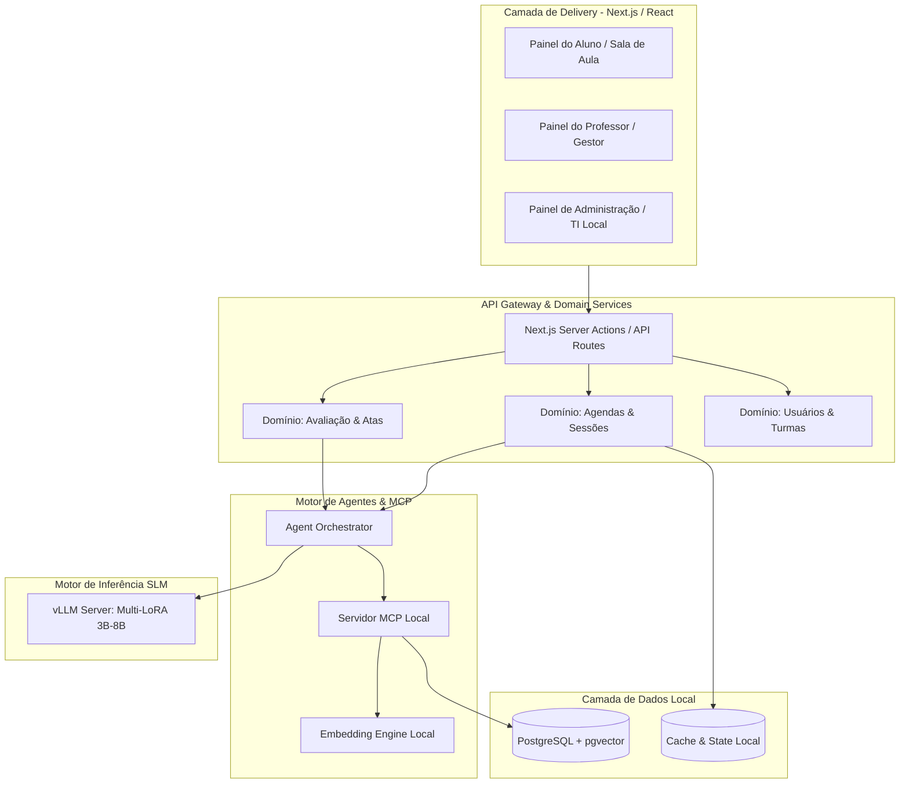

# 📋 Plano de Projeto: Soberania AI - Appliance Educacional On-Premises

> **Status:** 🟢 Concluído / Implementado  
> **Versão:** 1.2.0  
> **Arquitetura Base:** Next.js (App Router) + Local MCP Server + PostgreSQL com pgvector + vLLM Multi-SLM  
> **Design System & Identidade Visual:** [`docs/UX_UI_DESIGN_SYSTEM.md`](file:///c:/projects/soberania-ai/docs/UX_UI_DESIGN_SYSTEM.md) (Inspirado no ecossistema [Prof. Luci](https://www.prof-lu.com.br/))  
> **Protótipo Stitch:** Projeto Stitch ID `9396079196886748298` (`projects/9396079196886748298`)

---

## 🎯 1. Visão Geral e Objetivos do Produto

O **Soberania AI** é uma plataforma educacional proprietária baseada em **Appliance On-Premises (Plug-and-Play)** que assegura soberania absoluta de dados (LGPD) e previsibilidade de custos para redes escolares.

### 🌟 Diferenciais-Chave
1. **Multi-Agendas Especializadas:** O professor de IA não é apenas um chat passivo; ele atua em agendas síncronas programadas com regras e comportamentos específicos:
   - **Aula Interativa:** Player de vídeo sincronizado com checkpoints proativos da IA, FAQ dinâmico e emissão de ata pedagógica.
   - **Grupo de Estudos:** Mediação socrática de debates e resolução colaborativa de exercícios.
   - **Aplicação de Provas:** Ambiente seguro, cronometrado, com guardrails estritos anti-cola e correção diagnóstica.
   - **Acompanhamento de Trabalhos:** Feedback formativo em rascunhos e orientação por rubricas.
   - **Plantão de Dúvidas:** Atendimento sob demanda com priorização por fila.
2. **Especialização de SLMs (Multi-LoRA):** Cada agente opera com modelos leves (3B-8B) e adaptadores especializados por disciplina/papel, garantindo alta precisão e isolamento de contexto.
3. **RAG Híbrido Determinístico:** PostgreSQL + `pgvector` cruzando busca vetorial HNSW com busca léxica (Full-Text Search BM25) sobre o material oficial adotado pela escola.
4. **Protocolo MCP Embutido:** Ferramentas padronizadas para buscar material didático, registrar interações em tempo real e gerar atas pedagógicas.

---

## 🏗️ 2. Arquitetura do Sistema



---

## 🗓️ 3. Domínio das Multi-Agendas do Agente Professor

| Tipo de Agenda | Janela de Acesso | Comportamento do Agente | Ferramentas MCP Ativas | Output Final |
| :--- | :--- | :--- | :--- | :--- |
| **1. Aula Interativa** | Horário fixo (ex: 14h-16h) | **Proativo**: Pausa vídeos em timestamps-chave, faz perguntas socráticas, exibe FAQs frequentes. | `search_didactic_material`, `get_lesson_faqs`, `register_interaction` | **Ata Pedagógica de Aula** (Engajamento + Pontos de Atenção) |
| **2. Grupo de Estudo** | Agendamento coletivo | **Mediador**: Estimula discussão entre alunos, propõe desafios em grupo e resume conclusões. | `search_didactic_material`, `register_group_consensus` | **Relatório de Cooperação e Resumo do Tópico** |
| **3. Aplicação de Prova** | Horário rígido e cronometrado | **Fiscal & Avaliador**: Impede respostas diretas (guardrail anti-cola estrito), registra tempo por questão e hesitação. | `mcp_exam_proctor`, `submit_exam_answer` | **Boletim de Desempenho & Análise de Integridade** |
| **4. Orientação de Trabalho** | Janela de mentoria | **Orientador**: Avalia rascunhos de redação/projetos, sugere melhorias estruturais sem reescrever pelo aluno. | `review_draft_rubric`, `suggest_references` | **Parecer Formativo de Rascunho** |
| **5. Plantão de Dúvidas** | Horário flexível | **Tutor Socrático**: Responde dúvidas pontuais com base nas apostilas e sugere exercícios de fixação. | `search_didactic_material`, `get_lesson_faqs` | **Histórico de Dúvidas Sanadas** |

---

## 📦 4. Estrutura de Diretórios Implementada (DDD & Clean Code)

```
soberania-ai/
├── src/
│   ├── app/                               # Camada Delivery (Roteamento & Layouts)
│   │   ├── (student)/                     # Experiência do Aluno
│   │   │   ├── classroom/[sessionId]/     # Sala de Aula Interativa (Vídeo + Chat)
│   │   │   ├── study-group/[groupId]/     # Ambiente de Estudo em Grupo
│   │   │   ├── exam/[examId]/             # Sala de Prova Segura
│   │   │   └── dashboard/                 # Grade de Aulas, Atas e Notas
│   │   ├── (teacher)/                     # Painel do Professor / Gestor
│   │   │   ├── materials/                 # Upload e Gestão de PDFs Didáticos
│   │   │   └── reports/                   # Visualização de Atas e Desempenho
│   │   ├── (admin)/                       # Painel de Hardware & Sistema Local
│   │   │   └── appliance/                 # Console de Telemetria e Zero Egress
│   │   └── api/v1/                        # Endpoints SSE, MCP e Atas
│   ├── components/                        # UI Components (shadcn/ui)
│   │   ├── ui/                            # Botões, Dialogs, Cards, Badges
│   │   ├── layout/                        # AppHeader e TelemetryBadge
│   │   └── classroom/                     # VideoPlayer, ChatStream, FAQAccordion, MinutesViewer
│   ├── domains/                           # Lógica Pura de Domínio (DDD)
│   │   ├── agendas/                       # Regras de Horários, Tipos de Sessão e Validação
│   │   ├── agents/                        # Orquestração do Professor IA & Prompts Especializados
│   │   ├── pedagogy/                      # Motor de Atas, Avaliações e Métricas de Retenção
│   │   └── rag/                           # Busca Híbrida (HNSW + FTS) e Chunking
│   └── lib/                               # Infraestrutura & Integrações
│       ├── db.ts                          # Singleton Prisma Client (PostgreSQL)
│       ├── mcp/                           # Servidor MCP Local & Definição de Tools
│       └── vllm-client.ts                 # Conector de Inferência vLLM com Métricas
├── prisma/
│   ├── schema.prisma                      # Schema Relacional + pgvector
│   └── migrations/                        # Migrações Físicas Obrigatórias
├── docs/                                  # Documentação e Regras
│   ├── PRD.md                             # Documento de Requisitos de Produto
│   ├── UX_UI_DESIGN_SYSTEM.md             # Design System & Referência Prof. Luci
│   └── rules/                             # Regras de Clean Code, Data Table e Forms
└── tests/                                 # Testes Unitários e de Integração (Vitest)
```

---

## 🎨 4.1 Mapeamento de Telas no Stitch & Protótipos de Front-End

Todas as telas foram prototipadas no **Stitch (Google Deepmind Design System Engine)** no projeto **`Soberania AI` (ID: `9396079196886748298`)**, seguindo rigorosamente as diretrizes de cores, tipografia (Poppins + Inter), componentes shadcn/ui New York e micro-interações especificadas em [`docs/UX_UI_DESIGN_SYSTEM.md`](file:///c:/projects/soberania-ai/docs/UX_UI_DESIGN_SYSTEM.md).

### 📊 Matriz de Telas Prototipadas no Stitch

| # | Rota / Módulo | Nome da Tela no Stitch | Screen ID no Stitch | Papel do Usuário | Visualização do Screenshot |
|---|---|---|---|---|---|
| **01** | `/classroom/[sessionId]` | **Soberania AI - Sala de Aula Interativa** | `15ae4ecfda194b86817a2f5d8f91d390` | Aluno | [Ver Screenshot](https://lh3.googleusercontent.com/aida/AEtjO1VsdliQcgVx7iseBK8q5TcIOjVsDBps3fA-WnnFOv2vWDPIwa6HcVzs3wk9J83xiEjIe6eVx_WAvF9OawX7LbgrGVgLaIh8WEw93DWCmMI711pumyGY3NpkoqL4y3qwXHM9iLrlsJO6sAckPZS2GL11lWg3WE3Cx7tZ408HeWeFn6aJrGkhzsaRr7rIzn0V7oE5Dkr9uD3cuslZ-mlFDtU1lnD_AnZqkE-UaNGyh19LkBjjRNIVZM8IiMM) |
| **02** | `/study-group/[groupId]` | **Soberania AI - Grupo de Estudos Colaborativo** | `825badfe0354444188c3d4f51d399421` | Aluno (Grupo) | [Ver Screenshot](https://lh3.googleusercontent.com/aida/AEtjO1V6Zp3nx8Bvuc3mFScLxjykIMCC-ivrVCrNU75JBetjCvyvAJxmqMbAsqJeTsucPcLOZvLztr9id71CxkNvBoDRRQS8U0sdnpnTs-KcpCSBOI7D4s54ScVJwxWsFUvplVKj8utvsQXKzpQaJ-U2lwHJnRx21MGJR-s5kPA3WvrgxwUznaE3fUT1-7FDVdA-9dGj6BStJTtzRVwCzL9AtJGamIJWNMRXnhWpJMnkobzsHmBiKBzVOL70Ol0) |
| **03** | `/exam/[examId]` | **Soberania AI - Sala de Prova Supervisionada** | `a655ab0d54ee4f51b8d06af1de07af2b` | Aluno (Avaliação) | [Ver Screenshot](https://lh3.googleusercontent.com/aida/AEtjO1V1DUjJSVnueOC6D-bZCj7mnUbiAMHHZANgKlvmjZ6sDxM8RsRA5oYHhVgo0gPcEIdSxiyHB6ozzcSysZOU_rSyJ0hO-ZXq_k44Av9wXwK5wQepg8PVO9STu3yw4yqcpHvz4sHhivTwQuN0Y6mqOwka_tmoepB72_p3zS1sRvkeKW7Lq99zadOJZg3JYy2syGkzlMBbUpdHAHtJ1IVdoyx5p0qhlzV7iR8oYXg8BQO7xfP7RuM5WMGJyFU) |
| **04** | `/dashboard` | **Soberania AI - Painel Geral do Aluno** | `53c8d86fc6c54a148948c8acde0ca658` | Aluno | [Ver Screenshot](https://lh3.googleusercontent.com/aida/AEtjO1XZcx0_cfEKWSzP2xiIi3UoKB8J_n8pqcF5FDNctalBKxB0EdbNKDvnuNRwLa-W9TCj--cRYQ0zl2ZeS-9EQs7PRm8E2x3OmZi3-rlI4sGv90hgsroVGB4p02TEPe5KF_td95LiQEIcwrYx6vfTtiKwn6eZ6vrSCf4aH1L2AJNOvMTJjvwSEC3K3P4aeTfmuD8887yqGaLfLTQ6q54BZRR8Yhb4SEUMylfZyihtDi65bNCLPJYsoZIruSg) |
| **05** | `/reports` | **Soberania AI - Painel do Professor & Analytics** | `537a5b69d327494381bc3c8b15208e91` | Professor / Gestor | [Ver Screenshot](https://lh3.googleusercontent.com/aida/AEtjO1WTi0ed_wM7vfmmQFM8oi_CO35glaJug-UjiaJE0UGRd2xYDu21E8bv6p7n0xStbMBP949YbxTyYTJ4mGIcBEtERZh1roZCulbxyL4t2ISAFY-DfvMS8b5UyU1A_zRgo6tbtXhuUTezUMc7rUGj38TJahihwfIBdqkJRXShYJK2sRWbeC60lqWOApZIWqc2cGVyDd7RGrLtAajfHvuk-Ngtg1oPJ6rZ0m0t8z45qDPaX9IV7ws2LV9Tdto) |
| **06** | `/materials` | **Soberania AI - Gestão de Materiais RAG** | `ed2c8d08a54b423d960fd49eaf83a591` | Professor / TI | [Ver Screenshot](https://lh3.googleusercontent.com/aida/AEtjO1Wa8ewpeMj4V3-fjogaFIIpcDYjYtHfktpCkBrqkKVvJ6TnsxGqT1kdS5YBPvN3rT6J4jFW4zLWdSFc_ZsAlNhiYroRj6jz2-oY0AOyrAdRIJuXp0Ihx6c6LuqF-chcUi7dJwmABXlk9dUcXjTqKbnklEfab3xdgxG5l4E4DoA0LK5PrWFHxObwwj72bSbFciPRCjzRh3EdeMW9Bm7tt_VN6VwzEA9N6eFqwJHj_-JfBG4o1gCy06bjmsg) |
| **07** | `/appliance` | **Soberania AI - Hardware & Telemetria Appliance** | `57ca0d6e2e5e40e691ec55fe1b0bb753` | Administrador / TI | [Ver Screenshot](https://lh3.googleusercontent.com/aida/AEtjO1XB8CJYzkHL18XyRuiKXk4ibrpMe2uFJ4PMSZM3VMy5tnpnSjU807HY_h0_TyzLMlDFJNqjNn3J6wbF8GDJmGeip1g4AHSccLQA4Demunx2XSAIiOWA1GOEzUnubq1xnpo-p2qybQ0zyHqd1lpBgPcLBQwpApYs_Z6_MPp7_ium0xvcKyUwNuJePdAGchBeuwnJexCj3gcYc2bimynpOo_jyHVzy1bTJTE4vsWaIIUo7au5fyVKl0uMwO4) |

---

## 📋 5. Fases de Execução e Tarefas

### 🔹 Fase 1: Infraestrutura Base & Banco de Dados (RAG Híbrido)
- [x] Inicializar projeto Next.js + TypeScript + Tailwind + shadcn/ui.
- [x] Configurar Prisma Schema com tabelas de Usuários, Turmas, Materiais Didáticos (`material_chunks`), FAQs e Sessões de Agenda.
- [x] Gerar migração física inicial em `prisma/migrations/20260830000001_init/`.
- [x] Implementar serviço de busca híbrida RRF no PostgreSQL (pgvector + BM25).

### 🔹 Fase 2: Servidor MCP & Motor de Agentes Especializados
- [x] Desenvolver ferramentas MCP: `search_didactic_material`, `get_lesson_faqs`, `register_student_interaction` e `generate_class_minutes`.
- [x] Configurar cliente de inferência vLLM com suporte a troca de modelos / LoRA em runtime e telemetria de tokens.
- [x] Criar prompts de sistema especializados para os tipos de agenda (Aula, Prova, Grupo de Estudo, Plantão e Projeto).
- [x] Implementar guardrails determinísticos anti-cola e validação de janelas de horário.

### 🔹 Fase 3: Camada Delivery (Interfaces do Aluno e Professor)
- [x] Desenvolver Player de Vídeo Sincronizado com gatilhos de eventos em timestamps (Screen `15ae4ecfda194b86817a2f5d8f91d390`).
- [x] Desenvolver interface de Chat com Streaming de Tokens (SSE), exibição proativa de FAQs e cards de desafios socráticos.
- [x] Desenvolver Grupo de Estudos Colaborativo com Quadro de Resolução (Screen `825badfe0354444188c3d4f51d399421`).
- [x] Desenvolver componente e fluxo de visualização da **Ata Pedagógica de Aula** via `AdaptiveModal`.
- [x] Desenvolver ambiente seguro de aplicação de provas cronometradas (Screen `a655ab0d54ee4f51b8d06af1de07af2b`).
- [x] Desenvolver Painel Geral do Aluno com Grade de Multi-Agendas (Screen `53c8d86fc6c54a148948c8acde0ca658`).

### 🔹 Fase 4: Painel do Professor, Gestão de Materiais & Upload
- [x] Tela de upload e indexação de livros didáticos em PDF com simulador RRF (Screen `ed2c8d08a54b423d960fd49eaf83a591`).
- [x] Painel de acompanhamento de atas e analytics de retenção de alunos por turma (Screen `537a5b69d327494381bc3c8b15208e91`).
- [x] Console de Telemetria e Hardware do Appliance On-Premises (Screen `57ca0d6e2e5e40e691ec55fe1b0bb753`).
- [x] Gerenciador de agendas de aulas, provas e grupos de estudo.

### 🔹 Fase 5: Testes, Benchmarks & Preparação para Appliance
- [x] Testes unitários com Vitest (Camadas de Domínio, RAG, Validação, Guardrails e MCP Tools).
- [x] Validação estrita de tipos com `tsc --noEmit` e compilação de produção com `next build` (0 erros).

---

## 🔒 6. Critérios de Verificação & Aceite

1. **Soberania e Privacidade:** Nenhuma requisição de inferência ou embedding vaza para APIs externas na nuvem (0 bytes de tráfego externo).
2. **Precisão RAG:** As respostas do professor virtual citam trechos e páginas exatas do material didático oficial cadastrado.
3. **Respeito a Horários:** O aluno só pode interagir com o agente durante a janela de tempo autorizada pela agenda.
4. **Qualidade da Ata:** Toda sessão de aula encerrada gera um resumo estruturado com pontuação de engajamento, dúvidas feitas e pontos de atenção.
5. **Aderência ao Design System:** Toda a interface reflete as especificações de cores (Teal `#0F766E` / Orange `#F97316`), fontes e componentes shadcn/ui prototipados no Stitch.
6. **Zero-Error Build:** TypeScript estrito sem erros (`tsc --noEmit`), ESLint sem warnings e migrações físicas do Prisma sincronizadas.
