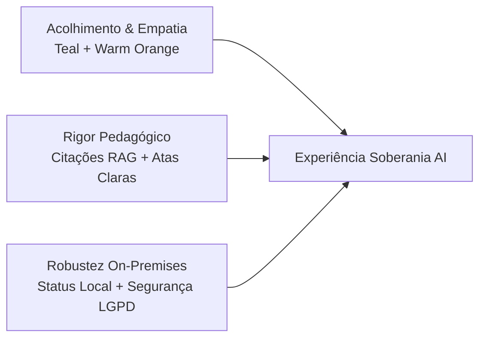

# 🎨 UX/UI Design System — Soberania AI

> **Status:** 🟢 Ativo & Referência Oficial de Front-End  
> **Versão:** 1.0.0  
> **Stack Base:** Next.js 16 (App Router) · React 19 · Tailwind CSS v4 · shadcn/ui (New York Style) · Lucide React  
> **Identidade & Paleta de Inspiração:** [Prof. Luci](https://www.prof-lu.com.br/) (Ecossistema Educacional com Inteligência Artificial Humanizada)  
> **Documentos Relacionados:** [`docs/PRD.md`](file:///c:/projects/soberania-ai/docs/PRD.md) · [`docs/PLAN-soberania-ai-appliance.md`](file:///c:/projects/soberania-ai/docs/PLAN-soberania-ai-appliance.md) · [`docs/rules/CLEAN_CODE.md`](file:///c:/projects/soberania-ai/docs/rules/CLEAN_CODE.md) · [`docs/rules/DATA_TABLE.md`](file:///c:/projects/soberania-ai/docs/rules/DATA_TABLE.md)

---

## 📑 Sumário

1. [🎯 Visão Geral & Filosofia Visual](#1--visão-geral--filosofia-visual)
2. [🎨 Paleta de Cores & Tokens Semânticos](#2--paleta-de-cores--tokens-semânticos)
3. [🔤 Tipografia & Hierarquia de Texto](#3--tipografia--hierarquia-de-texto)
4. [📐 Grid, Espaçamento, Raios & Elevação](#4--grid-espaçamento-raios--elevação)
5. [🧩 Componentes de Interface & Padrões Especializados](#5--componentes-de-interface--padrões-especializados)
   - [5.1 Botões & Interações](#51-botões--interações)
   - [5.2 Badges, Chips & Indicadores de Status](#52-badges-chips--indicadores-de-status)
   - [5.3 Cards & Contêineres de Conteúdo](#53-cards--contêineres-de-conteúdo)
   - [5.4 Chat Pedagógico & Citações de RAG](#54-chat-pedagógico--citações-de-rag)
   - [5.5 Player de Aula Interativa & Checkpoints](#55-player-de-aula-interativa--checkpoints)
   - [5.6 Atas Pedagógicas de Aula (Minutes)](#56-atas-pedagógicas-de-aula-minutes)
   - [5.7 Sala de Prova Segura & Guardrails Anti-Cola](#57-sala-de-prova-segura--guardrails-anti-cola)
   - [5.8 Widget de Telemetria do Appliance On-Premises](#58-widget-de-telemetria-do-appliance-on-premises)
6. [🌓 Suporte a Light & Dark Mode](#6--suporte-a-light--dark-mode)
7. [⚙️ Configuração dos Tokens CSS & Tailwind](#7--configuração-dos-tokens-css--tailwind)
8. [♿ Acessibilidade (a11y) & Usabilidade Escolar](#8--acessibilidade-a11y--usabilidade-escolar)
9. [📋 Checklist de Validação Visual Pré-Commit](#9--checklist-de-validação-visual-pré-commit)

---

## 1. 🎯 Visão Geral & Filosofia Visual

O **Soberania AI** é uma plataforma educacional corporativa e on-premises que combina a **robustez e a soberania tecnológica de um appliance de hardware local** com a **sensibilidade, o calor e a clareza pedagógica de uma tutoria humanizada**.

Inspirado na identidade do projeto **[Prof. Luci](https://www.prof-lu.com.br/)**, o design do Soberania AI rejeita interfaces frias, distópicas ou excessivamente "robóticas". O visual deve transmitir **acolhimento ao estudante**, **confiança institucional aos docentes e coordenadores** e **transparência total aos administradores de TI**.



### 🌟 Pilares Fundamentais de UX/UI

| Pilar | Princípio de Design | Aplicação Prática |
| :--- | :--- | :--- |
| **1. Empatia & Clareza** | Cores orgânicas, cantos arredondados e tipografia altamente legível. | Uso de Teal (`#0D9488`) como tom de confiança e Orange (`#F97316`) como calor humano e chamada à ação. |
| **2. Intencionalidade Pedagógica** | A interface guia o aluno no aprendizado sem entregar respostas fáceis. | Componentes dedicados para perguntas socráticas, pausas reflexivas no vídeo e badges de citação bibliográfica. |
| **3. Soberania & Transparência** | O usuário sempre sabe de onde veio a informação e o status do processamento. | Cards RAG com número da página do livro didático e badge de processamento 100% on-premises. |
| **4. Zero-Friction & Acessibilidade** | Foco cognitivo máximo, sem poluição visual ou elementos decorativos supérfluos. | Contraste WCAG AAA em textos de estudo, suporte integral a leitores de tela e estados de foco nítidos. |

---

## 2. 🎨 Paleta de Cores & Tokens Semânticos

A paleta de cores do Soberania AI herda o equilíbrio cromático do **Prof. Luci**, articulando tons primários de **Teal Profundo** (inteligência, calma, confiança), acentos de **Laranja Vibrante** (energia, acolhimento, interação) e neutros refinados de **Slate/Ink** para superfícies e tipografia.

### 2.1 Cores de Marca & Identidade

| Nome do Token | Valor HEX | HSL | Exemplo de Aplicação |
| :--- | :--- | :--- | :--- |
| **`brand-teal`** (Primária) | `#0D9488` | `hsl(175, 84%, 32%)` | Botões primários, cabeçalhos de destaque, links ativos, badges de conclusão. |
| **`brand-teal-dark`** | `#115E59` | `hsl(175, 68%, 22%)` | Hover de botões primários, cabeçalhos em modo claro. |
| **`brand-teal-light`** | `#CCFBF1` | `hsl(167, 85%, 89%)` | Fundos de cards pedagógicos, badges suaves de IA, destaques de texto. |
| **`brand-orange`** (Secundária/Acento) | `#F97316` | `hsl(25, 95%, 53%)` | Badges de alerta socrático, anotações de atenção, avatares de IA, botões de ação especial. |
| **`brand-orange-dark`** | `#EA580C` | `hsl(20, 91%, 48%)` | Hover de botões de destaque, bordas ativas. |
| **`brand-orange-light`** | `#FFEDD5` | `hsl(34, 100%, 92%)` | Fundos de caixas de perguntas reflexivas, alertas amigáveis. |
| **`brand-ink`** (Superfície Dark/Texto) | `#0F172A` | `hsl(222, 47%, 11%)` | Texto principal em modo claro, fundo de seções hero/dark e console do appliance. |
| **`brand-canvas`** (Fundo Geral Light) | `#F8FAFC` | `hsl(210, 40%, 98%)` | Fundo padrão da aplicação em modo claro (warm off-white). |

### 2.2 Cores Funcionais & Semânticas

| Papel Semântico | Token | HEX | Finalidade no Domínio |
| :--- | :--- | :--- | :--- |
| **Sucesso / Online** | `brand-green` | `#10B981` | Status "Agente Online", aluno presente, ata gerada, prova submetida com sucesso. |
| **Atenção / Dúvida** | `brand-amber` | `#F59E0B` | Cronômetro de prova < 5 min, aluno hesitante, dúvida pendente de mediação. |
| **Erro / Bloqueio** | `brand-rose` | `#F43F5E` | Tentativa de cola (Guardrail), ausência em aula síncrona, falha de processamento local. |
| **Referência / RAG** | `brand-blue` | `#0284C7` | Citação de material didático oficial `[Livro, pág. X]`, download de apostila. |
| **Mediação / Grupo** | `brand-indigo`| `#6366F1` | Salas de grupo de estudos, votações de consenso entre pares. |

---

## 3. 🔤 Tipografia & Hierarquia de Texto

Para harmonizar com a identidade acolhedora e moderna do [Prof. Luci](https://www.prof-lu.com.br/), adotamos a família **Poppins** para títulos e elementos de destaque da marca, combinada com a família **Inter** (ou **Plus Jakarta Sans**) para leitura densa, chats, relatórios e tabelas.

### 3.1 Famílias Tipográficas

- **Heading / Display:** `'Poppins', -apple-system, BlinkMacSystemFont, sans-serif`  
  *Características:* Formas arredondadas e geométricas que transmitem gentileza, modernidade e empatia.
- **Body / Interface:** `'Inter', -apple-system, BlinkMacSystemFont, sans-serif`  
  *Características:* Máxima legibilidade em telas pequenas, excelente para leitura de respostas longas da IA e atas escolares.
- **Code / Mono:** `'JetBrains Mono', 'Fira Code', monospace`  
  *Características:* Para fórmulas matemáticas do sandbox Python, códigos-fonte e logs do appliance local.

### 3.2 Escala Tipográfica Padronizada

| Nível / Elemento | Classe Tailwind | Tamanho / Line-Height | Peso | Tracking |
| :--- | :--- | :--- | :--- | :--- |
| **Display Hero (H1)** | `text-4xl sm:text-5xl lg:text-[3.25rem]` | `48px - 52px / 1.15` | `font-bold` (700/800) | `tracking-tight` |
| **Título de Seção (H2)**| `text-2xl sm:text-3xl lg:text-4xl` | `30px - 36px / 1.2` | `font-bold` (700) | `tracking-tight` |
| **Título de Card/Módulo (H3)**| `text-lg sm:text-xl` | `20px / 1.3` | `font-semibold` (600) | `tracking-normal` |
| **Subtítulo / Lead** | `text-base sm:text-lg` | `18px / 1.6` | `font-normal` (400/500) | `tracking-normal` |
| **Corpo Padrão (Body)**| `text-sm sm:text-base` | `14px - 16px / 1.5` | `font-normal` (400) | `tracking-normal` |
| **Chat Bubble / Mensagens**| `text-[13px] sm:text-sm` | `13px - 14px / 1.55` | `font-normal` (400) | `tracking-normal` |
| **Citações RAG / Badges**| `text-xs` ou `text-[11px]` | `11px - 12px / 1.4` | `font-medium` (500/600) | `tracking-wider` |
| **Micro Legendas** | `text-[10px]` | `10px / 1.2` | `font-semibold` (600) | `tracking-widest` |

---

## 4. 📐 Grid, Espaçamento, Raios & Elevação

### 4.1 Escala de Raios de Borda (`Border Radius`)

Seguindo o estilo moderno do Prof. Luci, privilegiamos curvas amigáveis:

- **Chips / Badges / Status Pills:** `rounded-full` (9999px)
- **Cards / Modais / Painéis de Chat:** `rounded-2xl` (16px) ou `rounded-3xl` (24px)
- **Botões / Inputs / Selects:** `rounded-xl` (12px)
- **Ícones em Contêineres:** `rounded-xl` (12px)
- **Balões de Conversa:** `rounded-2xl rounded-br-md` (Aluno) / `rounded-2xl rounded-bl-md` (IA)

### 4.2 Elevação & Sombras (`Shadows & Glows`)

```css
/* Sombras suaves e naturais em Tailwind */
.shadow-soft-sm {
  box-shadow: 0 1px 2px 0 rgba(15, 23, 42, 0.04);
}

.shadow-soft-md {
  box-shadow: 0 4px 12px -2px rgba(15, 23, 42, 0.06), 0 2px 6px -1px rgba(15, 23, 42, 0.04);
}

.shadow-soft-xl {
  box-shadow: 0 20px 30px -8px rgba(15, 23, 42, 0.07), 0 8px 12px -4px rgba(15, 23, 42, 0.03);
}

/* Glow decorativo de fundo inspirado no Prof. Luci */
.bg-ambient-glow {
  background: radial-gradient(circle at 10% 20%, rgba(13, 148, 136, 0.08) 0%, transparent 40%),
              radial-gradient(circle at 90% 80%, rgba(249, 115, 22, 0.08) 0%, transparent 40%);
}
```

---

## 5. 🧩 Componentes de Interface & Padrões Especializados

### 5.1 Botões & Interações

Os botões utilizam altura padrão `h-11` ou `h-12` com raios `rounded-xl` e tipografia `font-semibold`.

```tsx
// 1. Botão Primário (Brand Teal)
<button className="inline-flex items-center justify-center gap-2 h-11 px-5 rounded-xl bg-brand-teal hover:bg-brand-teal-dark text-white font-semibold shadow-sm transition-all active:scale-[0.98] cursor-pointer">
  <span>Entrar na Aula Interativa</span>
  <ArrowRight className="h-4 w-4" />
</button>

// 2. Botão Secundário / Acento (Brand Orange)
<button className="inline-flex items-center justify-center gap-2 h-11 px-5 rounded-xl bg-brand-orange hover:bg-brand-orange-dark text-white font-semibold shadow-sm transition-all active:scale-[0.98] cursor-pointer">
  <span>Iniciar Desafio Socrático</span>
  <Sparkles className="h-4 w-4" />
</button>

// 3. Botão Outline Neutro
<button className="inline-flex items-center justify-center gap-2 h-11 px-5 rounded-xl border border-slate-300 dark:border-slate-700 bg-white dark:bg-slate-900 text-slate-700 dark:text-slate-200 hover:border-brand-teal hover:text-brand-teal font-semibold transition-all cursor-pointer">
  <span>Ver Material Didático</span>
  <BookOpen className="h-4 w-4" />
</button>
```

### 5.2 Badges, Chips & Indicadores de Status

Seguindo o padrão de pills do [Prof. Luci](https://www.prof-lu.com.br/):

```tsx
// Pill Badge de Categoria
<span className="inline-flex items-center gap-1.5 rounded-full bg-brand-orange/10 border border-brand-orange/20 px-3 py-1 text-xs font-semibold uppercase tracking-wider text-brand-orange">
  Aula Interativa Síncrona
</span>

// Status do Agente Online
<span className="inline-flex items-center gap-1.5 rounded-full bg-emerald-500/10 border border-emerald-500/20 px-2.5 py-0.5 text-xs font-medium text-emerald-600 dark:text-emerald-400">
  <span className="h-1.5 w-1.5 rounded-full bg-emerald-500 animate-pulse" />
  Professor IA Online · Banco de Dados
</span>

// Selo de Soberania On-Premises
<span className="inline-flex items-center gap-1.5 rounded-full bg-brand-teal/10 border border-brand-teal/20 px-2.5 py-0.5 text-xs font-medium text-brand-teal">
  <ShieldCheck className="h-3.5 w-3.5" />
  100% On-Premises · LGPD Safe
</span>
```

### 5.3 Cards & Contêineres de Conteúdo

```tsx
<div className="rounded-2xl border border-slate-200 dark:border-slate-800 bg-white dark:bg-slate-900 p-6 shadow-sm hover:border-brand-teal/30 hover:shadow-soft-md transition-all">
  <div className="flex items-start justify-between gap-3 mb-4">
    <div className="h-11 w-11 rounded-xl bg-brand-teal/10 flex items-center justify-center text-brand-teal">
      <GraduationCap className="h-5 w-5" />
    </div>
    <span className="rounded-full bg-slate-100 dark:bg-slate-800 px-2.5 py-1 text-[10px] font-semibold uppercase tracking-wider text-slate-600 dark:text-slate-400">
      Disponível Agora
    </span>
  </div>
  <h3 className="font-heading font-semibold text-lg text-slate-900 dark:text-white mb-2">
    Normalização e Modelagem Relacional
  </h3>
  <p className="text-sm text-slate-600 dark:text-slate-400 leading-relaxed">
    Aula com checkpoints de IA e resolução mediada de exercícios práticos.
  </p>
</div>
```

---

### 5.4 Chat Pedagógico & Citações de RAG

O painel de chat foi projetado para destacar **a voz do aluno**, **a autoridade do material do professor** e **a citação explícita das fontes** (evitando alucinações).

```tsx
<div className="flex flex-col space-y-4 p-4">
  {/* Mensagem do Aluno */}
  <div className="flex justify-end">
    <div className="max-w-[85%] rounded-2xl rounded-br-md px-4 py-3 text-sm leading-relaxed bg-brand-teal text-white shadow-sm">
      <p>Professora, como funciona a 3ª Forma Normal (3FN) no nosso banco de dados?</p>
    </div>
  </div>

  {/* Resposta do Agente Professor */}
  <div className="flex justify-start items-start gap-3">
    {/* Avatar com Anel Laranja */}
    <div className="relative shrink-0">
      
      <span className="absolute bottom-0 right-0 h-2.5 w-2.5 rounded-full bg-emerald-500 ring-2 ring-white" />
    </div>

    <div className="max-w-[85%] space-y-2">
      <div className="rounded-2xl rounded-bl-md px-4 py-3 text-sm leading-relaxed bg-slate-100 dark:bg-slate-800 text-slate-800 dark:text-slate-100 border border-slate-200/60 dark:border-slate-700/60 shadow-sm">
        <p className="font-semibold text-xs text-brand-teal mb-1">Tutora I.A Soberania</p>
        <p>
          A 3ª Forma Normal exige que a tabela já esteja na 2FN e que **nenhuma coluna não-chave dependa de outra coluna não-chave** (eliminação de dependências transitivas).
        </p>
        
        {/* Chip de Citação Bibliográfica RAG */}
        <div className="mt-3 pt-2.5 border-t border-slate-200/70 dark:border-slate-700/70 flex items-center justify-between">
          <button className="inline-flex items-center gap-1.5 text-[11px] font-semibold text-brand-teal hover:underline cursor-pointer">
            <BookOpen className="h-3.5 w-3.5" />
            <span>Apostila Oficial BD · Capítulo 4, pág. 58</span>
          </button>
          <span className="text-[10px] text-slate-600 dark:text-slate-400">98% de aderência RAG</span>
        </div>
      </div>
    </div>
  </div>
</div>
```

---

### 5.5 Player de Aula Interativa & Checkpoints

A tela de aula sincroniza o vídeo com interrupções intencionais da IA:

```
+-------------------------------------------------------------------------+
| [Header] Aula 04: Estruturas de Repetição em Python       [100% Local]  |
+---------------------------------------------+---------------------------+
|                                             | [Aba: Chat Socrático]     |
|              PLAYER DE VÍDEO                |                           |
|                                             |  IA: "Pausei o vídeo para |
|     (00:14:32 / 00:45:00)                   |  uma pergunta rápida:"    |
|                                             |                           |
|  [==================●=======|=============] |  "O que acontece se a     |
|                    (Ponto de Pausa IA)      |  condição do `while` não  |
|                                             |  for atualizada?"         |
|  [FAQ Dinâmico da Aula]                     |                           |
|  - Dúvida 1: Diferença entre for e while    |  [ Sua resposta...      ] |
|  - Dúvida 2: Como evitar loop infinito      |  [ Enviar Resposta (Enter)]
+---------------------------------------------+---------------------------+
```

---

### 5.6 Atas Pedagógicas de Aula (Minutes)

Ao término de cada sessão (aula síncrona, grupo ou plantão), a IA emite a **Ata Pedagógica**:

```tsx
<div className="rounded-2xl border border-slate-200 dark:border-slate-800 bg-white dark:bg-slate-900 p-6 shadow-soft-md">
  <div className="flex items-center justify-between pb-4 border-b border-slate-100 dark:border-slate-800">
    <div>
      <span className="text-xs font-semibold uppercase tracking-wider text-brand-teal">
        Documento Oficial
      </span>
      <h2 className="text-xl font-bold text-slate-900 dark:text-white mt-0.5">
        Ata Pedagógica de Sessão Síncrona
      </h2>
    </div>
    <button className="inline-flex items-center gap-1.5 h-9 px-3.5 rounded-lg border border-slate-300 dark:border-slate-700 text-xs font-semibold hover:bg-slate-50 dark:hover:bg-slate-800 transition-colors">
      <FileDown className="h-3.5 w-3.5" />
      Exportar PDF
    </button>
  </div>

  {/* Grade de Indicadores */}
  <div className="grid grid-cols-3 gap-4 py-4 border-b border-slate-100 dark:border-slate-800">
    <div className="p-3 rounded-xl bg-slate-50 dark:bg-slate-800/50">
      <span className="text-xs text-slate-600 dark:text-slate-400">Engajamento</span>
      <p className="text-xl font-bold text-brand-teal mt-0.5">94%</p>
    </div>
    <div className="p-3 rounded-xl bg-slate-50 dark:bg-slate-800/50">
      <span className="text-xs text-slate-600 dark:text-slate-400">Dúvidas Levantadas</span>
      <p className="text-xl font-bold text-slate-900 dark:text-white mt-0.5">4</p>
    </div>
    <div className="p-3 rounded-xl bg-slate-50 dark:bg-slate-800/50">
      <span className="text-xs text-slate-600 dark:text-slate-400">Domínio do Conteúdo</span>
      <p className="text-xl font-bold text-emerald-600 mt-0.5">Excelente</p>
    </div>
  </div>

  {/* Diagnóstico Qualitativo */}
  <div className="mt-4 space-y-3 text-sm">
    <h4 className="font-semibold text-slate-800 dark:text-slate-200">Pontos de Fixação:</h4>
    <ul className="list-disc list-inside text-slate-600 dark:text-slate-400 space-y-1">
      <li>Compreendeu a sintaxe do loop com contador incrementado.</li>
      <li>Apresentou leve hesitação na condição de parada booleana (revisar slide 14).</li>
    </ul>
  </div>
</div>
```

---

### 5.7 Sala de Prova Segura & Guardrails Anti-Cola

Durante avaliações cronometradas, a interface assume um modo de foco estrito com contador regressivo e proteção contra respostas prontas:

```tsx
<div className="rounded-2xl border-2 border-brand-orange/30 bg-white dark:bg-slate-900 p-6">
  <div className="flex items-center justify-between">
    <div className="flex items-center gap-2 text-brand-orange font-semibold text-sm">
      <ShieldAlert className="h-4 w-4" />
      <span>Ambiente de Avaliação Supervisionada</span>
    </div>
    {/* Cronômetro com Alerta Visual */}
    <div className="flex items-center gap-1.5 font-mono text-lg font-bold text-rose-600 bg-rose-50 dark:bg-rose-950/40 px-3 py-1 rounded-lg border border-rose-200 dark:border-rose-900">
      <Clock className="h-4 w-4" />
      <span>00:18:42</span>
    </div>
  </div>

  {/* Card de Bloqueio Educado da IA */}
  <div className="mt-4 p-4 rounded-xl bg-amber-50 dark:bg-amber-950/30 border border-amber-200 dark:border-amber-900/50 text-amber-900 dark:text-amber-200 text-sm">
    <p className="font-semibold flex items-center gap-1.5 mb-1">
      <Info className="h-4 w-4 text-amber-600" />
      Orientação do Agente Fiscal:
    </p>
    <p className="text-xs leading-relaxed">
      "Esta é uma avaliação formal. Não posso fornecer o gabarito ou validar sua alternativa antes da submissão. Responda com base no que estudamos nas aulas 1 a 6."
    </p>
  </div>
</div>
```

---

### 5.8 Widget de Telemetria do Appliance On-Premises

Exibido no painel de administração e rodapé para garantir transparência operacional:

```tsx
<div className="flex items-center gap-4 px-4 py-2 rounded-xl bg-slate-900 text-white text-xs">
  <div className="flex items-center gap-1.5">
    <span className="h-2 w-2 rounded-full bg-emerald-400 animate-pulse" />
    <span className="font-semibold">Appliance vLLM: Ativo</span>
  </div>
  <div className="h-3 w-px bg-slate-700" />
  <span className="text-slate-400">TTFT: <strong className="text-slate-200">0.82s</strong></span>
  <div className="h-3 w-px bg-slate-700" />
  <span className="text-slate-400">Tokens/s: <strong className="text-slate-200">64.5</strong></span>
  <div className="h-3 w-px bg-slate-700" />
  <span className="text-slate-400">Tráfego Externo: <strong className="text-emerald-400">0 KB (100% Local)</strong></span>
</div>
```

---

## 6. 🌓 Suporte a Light & Dark Mode

O design system suporta alternância fluida entre temas, preservando sempre o conforto visual e o contraste exigido em salas de aula e estudos noturnos.

### Mapeamento de Superfícies

| Elemento | Modo Claro (`light`) | Modo Escuro (`dark`) |
| :--- | :--- | :--- |
| **Canvas / Background** | `#F8FAFC` (`bg-slate-50`) | `#0B1120` (`bg-slate-950`) |
| **Superfície dos Cards** | `#FFFFFF` (`bg-white`) | `#131D31` (`bg-slate-900`) |
| **Bordas Estruturais** | `#E2E8F0` (`border-slate-200`) | `#1E293B` (`border-slate-800`) |
| **Texto Primário** | `#0F172A` (`text-slate-900`) | `#F8FAFC` (`text-slate-50`) |
| **Texto Secundário / Apoio**| `#64748B` (`text-slate-500`) | `#94A3B8` (`text-slate-400`) |
| **Bolha do Aluno** | `#0D9488` (`bg-brand-teal`) | `#0D9488` (`bg-brand-teal`) |
| **Bolha da IA** | `#F1F5F9` (`bg-slate-100`) | `#1E293B` (`bg-slate-800`) |

---

## 7. ⚙️ Configuração dos Tokens CSS & Tailwind

Abaixo estão as variáveis CSS padrão a serem incluídas no arquivo `src/app/globals.css`:

```css
@tailwind base;
@tailwind components;
@tailwind utilities;

@layer base {
  :root {
    /* Cores de Fundo e Texto Base */
    --background: 210 40% 98%;      /* #F8FAFC */
    --foreground: 222 47% 11%;      /* #0F172A */

    /* Cards e Superfícies */
    --card: 0 0% 100%;              /* #FFFFFF */
    --card-foreground: 222 47% 11%;

    --popover: 0 0% 100%;
    --popover-foreground: 222 47% 11%;

    /* Marca: Teal (Primária) */
    --primary: 175 84% 32%;         /* #0D9488 */
    --primary-foreground: 0 0% 100%;
    --primary-dark: 175 68% 22%;    /* #115E59 */
    --primary-light: 167 85% 89%;   /* #CCFBF1 */

    /* Marca: Warm Orange (Acento/Secundária) */
    --secondary: 25 95% 53%;        /* #F97316 */
    --secondary-foreground: 0 0% 100%;
    --secondary-dark: 20 91% 48%;   /* #EA580C */
    --secondary-light: 34 100% 92%; /* #FFEDD5 */

    /* Neutros e Muted */
    --muted: 210 40% 96.1%;
    --muted-foreground: 215.4 16.3% 46.9%;

    --accent: 210 40% 96.1%;
    --accent-foreground: 222.2 47.4% 11.2%;

    --destructive: 350 89% 60%;     /* #F43F5E */
    --destructive-foreground: 210 40% 98%;

    --border: 214.3 31.8% 91.4%;    /* #E2E8F0 */
    --input: 214.3 31.8% 91.4%;
    --ring: 175 84% 32%;

    --radius: 0.75rem;              /* 12px */
  }

  .dark {
    --background: 224 71% 4%;       /* #0B1120 */
    --foreground: 210 40% 98%;

    --card: 222 47% 11%;            /* #0F172A */
    --card-foreground: 210 40% 98%;

    --popover: 222 47% 11%;
    --popover-foreground: 210 40% 98%;

    --primary: 175 84% 38%;         /* #14B8A6 */
    --primary-foreground: 0 0% 100%;

    --secondary: 25 95% 53%;        /* #F97316 */
    --secondary-foreground: 0 0% 100%;

    --muted: 217.2 32.6% 17.5%;
    --muted-foreground: 215 20.2% 65.1%;

    --accent: 217.2 32.6% 17.5%;
    --accent-foreground: 210 40% 98%;

    --destructive: 350 89% 60%;
    --destructive-foreground: 210 40% 98%;

    --border: 217.2 32.6% 17.5%;
    --input: 217.2 32.6% 17.5%;
    --ring: 175 84% 38%;
  }
}
```

---

## 8. ♿ Acessibilidade (a11y) & Usabilidade Escolar

1. **Contraste de Cor Rigoroso:** Todas as combinações de texto e fundo devem atingir a proporção mínima de **4.5:1** (WCAG AA) para textos normais e **7:1** (WCAG AAA) para conteúdos didáticos centrais.
2. **Navegação por Teclado:** Todo botão, link, input e player interativo deve possuir anel de foco visível (`focus-visible:ring-2 focus-visible:ring-brand-teal focus-visible:outline-none`).
3. **Leitores de Tela:**
   - Ícones decorativos devem conter `aria-hidden="true"`.
   - Elementos interativos apenas com ícones devem possuir `aria-label` descritivo em português (ex: `aria-label="Exportar Ata Pedagógica em PDF"`).
4. **Respeito a Movimento Reduzido:** Suporte nativo a `@media (prefers-reduced-motion: reduce)` desabilitando transições e pulsações intensas.

---

## 9. 📋 Checklist de Validação Visual Pré-Commit

Antes de submeter qualquer PR ou finalizar uma tela no Soberania AI:

- [ ] **Paleta de Cores:** Usou `brand-teal` como primária e `brand-orange` para pontos de calor/atenção pedagógica?
- [ ] **Fontes:** Títulos com `Poppins` e corpo de texto com `Inter`?
- [ ] **Citações RAG:** Respostas do agente possuem o chip `[Livro/Capítulo/Página]` formatado?
- [ ] **Modo Escuro:** As cores mantêm legibilidade e contraste nos dois modos (`light`/`dark`)?
- [ ] **Interatividade:** Botões e cards possuem `cursor-pointer`, estados de hover suaves e `active:scale-[0.98]`?
- [ ] **shadcn/ui:** Componentes base foram importados de `@/components/ui/*` (New York style)?
- [ ] **Sem Emojis como Ícones:** Utilizou apenas SVGs do `lucide-react`?
