# Design Patterns — Referência Swapo Finance

> 📚 Catálogo de padrões de projeto adaptados para **TypeScript + Node.js + Next.js 16**.
> Cada padrão inclui um exemplo prático alinhado à **arquitetura DDD** e ao **domínio de negócio** da Swapo (câmbio, ledger, pagamentos, webhooks).

---

## Sumário

| # | Padrão | Categoria | Onde já usamos |
|---|--------|-----------|----------------|
| 1 | [Strategy](#1-strategy) | Behavioral | Webhook handlers |
| 2 | [Registry](#2-registry) | Creational | Exchange providers |
| 3 | [Factory](#3-factory) | Creational | Error classes, Loggers |
| 4 | [Singleton](#4-singleton--module-singleton) | Creational | DB client, Redis, Inngest |
| 5 | [Repository](#5-repository) | Structural (DDD) | Domain services |
| 6 | [Adapter](#6-adapter) | Structural | Payment provider clients |
| 7 | [Facade](#7-facade) | Structural | Barrel exports, Domain APIs |
| 8 | [Observer / Pub-Sub](#8-observer--pub-sub) | Behavioral | Pusher, Inngest events |
| 9 | [Builder](#9-builder) | Creational | Query builders, Cache keys |
| 10 | [Decorator](#10-decorator--higher-order-function) | Structural | Middleware, Rate limiting |
| 11 | [Chain of Responsibility](#11-chain-of-responsibility) | Behavioral | Middleware pipeline |
| 12 | [Result Pattern (Either)](#12-result-pattern-either) | Functional | Service return types |
| 13 | [Value Object](#13-value-object) | DDD | Domain primitives |
| 14 | [Module Pattern (Barrel Export)](#14-module-pattern-barrel-export) | Structural | Todos os domínios |

---

## Princípios Fundamentais

Antes de aplicar qualquer padrão, considere:

| Princípio | Regra |
|-----------|-------|
| **KISS** | Não use um padrão se uma função simples resolve |
| **YAGNI** | Não adicione abstração "preventiva" |
| **Composition > Inheritance** | Prefira composição de funções a hierarquias de classes |
| **Functional-First** | Use classes apenas quando o padrão genuinamente se beneficia de estado encapsulado |
| **Type Safety** | Todo padrão deve ser tipado. Nunca `any` |

---

## 1. Strategy

**Categoria:** Behavioral  
**Problema:** Diferentes algoritmos precisam ser executados para a mesma operação, variando por contexto (ex.: provider de webhook, tipo de evento).  
**Solução:** Definir uma interface comum e implementações intercambiáveis.

> **Onde usamos:** `src/domains/webhook/handlers/` — cada webhook handler (Brasil Cash PIX Cashin, PIX Cashout) implementa a interface `WebhookHandler`.

### Diagrama

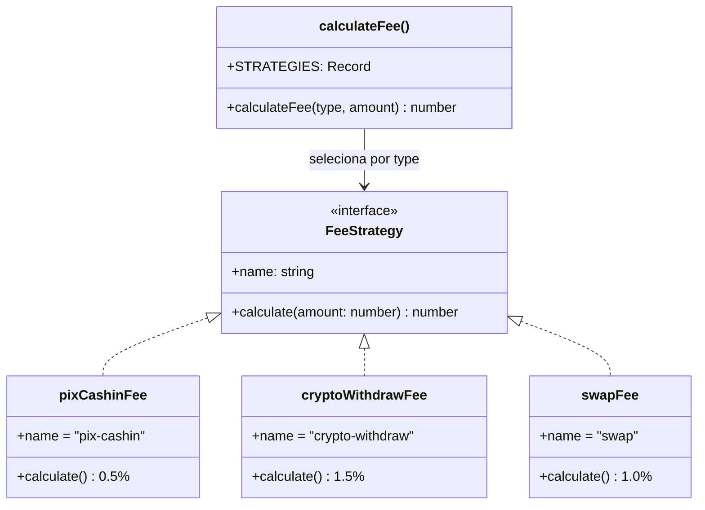

### Exemplo — Cálculo de taxa por tipo de transação

```typescript
// src/domains/transaction/strategies/fee-strategy.ts

// ─── Interface da Estratégia ────────────────────────────────────

interface FeeStrategy {
    readonly name: string;
    calculate(amount: number): number;
}

// ─── Implementações ─────────────────────────────────────────────

const pixCashinFee: FeeStrategy = {
    name: 'pix-cashin',
    calculate: (amount) => amount * 0.005,   // 0.5%
};

const cryptoWithdrawFee: FeeStrategy = {
    name: 'crypto-withdraw',
    calculate: (amount) => amount * 0.015,   // 1.5%
};

const swapFee: FeeStrategy = {
    name: 'swap',
    calculate: (amount) => amount * 0.01,    // 1.0%
};

// ─── Context ────────────────────────────────────────────────────

const STRATEGIES: Record<string, FeeStrategy> = {
    PIX_CASHIN: pixCashinFee,
    CRYPTO_WITHDRAW: cryptoWithdrawFee,
    SWAP: swapFee,
} as const;

export const calculateFee = (type: keyof typeof STRATEGIES, amount: number): number => {
    const strategy = STRATEGIES[type];
    if (!strategy) throw new Error(`Fee strategy not found: ${type}`);
    return strategy.calculate(amount);
};
```

### Quando usar

- ✅ Múltiplas variações do mesmo comportamento (ex.: taxas, validações, cálculos)
- ✅ Eliminar longas cadeias `if/else` ou `switch`
- ❌ Quando há apenas uma implementação e não se espera mais

---

## 2. Registry

**Categoria:** Creational  
**Problema:** Componentes (providers, handlers) precisam ser registrados e consultados em runtime sem acoplamento direto.  
**Solução:** Um `Map` central onde cada componente se registra e pode ser buscado por chave.

> **Onde usamos:** `src/domains/webhook/handlers/index.ts` — registry de `WebhookHandler` por chave `provider:eventType`. Também `src/domains/exchange/services.ts` com registry de `ExchangeProvider`.

### Diagrama

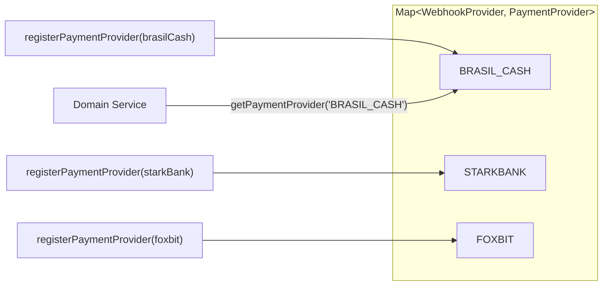

### Exemplo — Registry de provedores de pagamento

```typescript
// src/infrastructure/integrations/payment-providers/registry.ts

import type { WebhookProvider } from '@/domains/webhook/types';

// ─── Interface ──────────────────────────────────────────────────

interface PaymentProvider {
    readonly name: WebhookProvider;
    processPayment(amount: number, pixKey: string): Promise<{ txId: string }>;
    getStatus(txId: string): Promise<string>;
}

// ─── Registry ───────────────────────────────────────────────────

const providers = new Map<WebhookProvider, PaymentProvider>();

export const registerPaymentProvider = (provider: PaymentProvider): void => {
    providers.set(provider.name, provider);
};

export const getPaymentProvider = (name: WebhookProvider): PaymentProvider => {
    const provider = providers.get(name);
    if (!provider) throw new Error(`Payment provider not registered: ${name}`);
    return provider;
};

export const getAllPaymentProviders = (): ReadonlyMap<WebhookProvider, PaymentProvider> =>
    providers;
```

### Quando usar

- ✅ Sistema de plugins ou múltiplos providers
- ✅ Extensibilidade sem modificar código existente (OCP)
- ❌ Quando a relação é 1:1 e estática

---

## 3. Factory

**Categoria:** Creational  
**Problema:** A criação de objetos envolve lógica condicional ou configuração complexa.  
**Solução:** Uma função (ou classe) dedicada à criação, centralizando a lógica de instanciação.

> **Onde usamos:** Classes de erro especializadas (`BrasilCashApiError`), `createModuleLogger()`.

### Diagrama

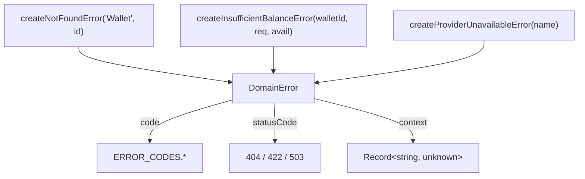

### Exemplo — Factory de erros de domínio

```typescript
// src/shared/errors/error-factory.ts

import { ERROR_CODES } from '@/lib/constants/error-codes';

// ─── Tipos de Erro ──────────────────────────────────────────────

class DomainError extends Error {
    readonly code: string;
    readonly statusCode: number;
    readonly context?: Record<string, unknown>;

    constructor(message: string, code: string, statusCode: number, context?: Record<string, unknown>) {
        super(message);
        this.name = 'DomainError';
        this.code = code;
        this.statusCode = statusCode;
        this.context = context;
    }
}

// ─── Factory Functions ──────────────────────────────────────────

export const createNotFoundError = (entity: string, id: string) =>
    new DomainError(
        `${entity} not found: ${id}`,
        ERROR_CODES.NOT_FOUND,
        404,
        { entity, id },
    );

export const createInsufficientBalanceError = (walletId: string, required: string, available: string) =>
    new DomainError(
        `Insufficient balance in wallet ${walletId}`,
        ERROR_CODES.INSUFFICIENT_BALANCE,
        422,
        { walletId, required, available },
    );

export const createProviderUnavailableError = (providerName: string) =>
    new DomainError(
        `Provider ${providerName} is unavailable`,
        ERROR_CODES.EXCHANGE_PROVIDER_UNAVAILABLE,
        503,
        { provider: providerName },
    );
```

### Quando usar

- ✅ Criação de objetos com múltiplos parâmetros ou variações
- ✅ Encapsular detalhes de construção (error codes, defaults)
- ❌ Quando `new ClassName()` é suficiente e direto

---

## 4. Singleton / Module Singleton

**Categoria:** Creational  
**Problema:** Recursos compartilhados (conexão DB, cliente Redis) devem ter uma única instância global.  
**Solução:** Em Node.js/TypeScript, o sistema de módulos garante singleton natural — o módulo é executado uma vez e o valor exportado é cacheado.

> **Onde usamos:** `src/lib/db.ts` (Prisma client), `src/lib/pusher.ts` (Pusher), `src/lib/inngest/` (Inngest client).

### Diagrama

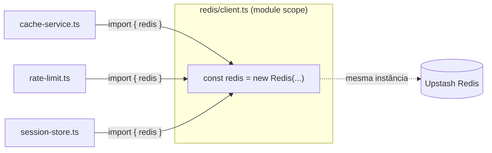

### Exemplo — Singleton de cliente Redis

```typescript
// src/infrastructure/integrations/services/redis/client.ts

import { Redis } from '@upstash/redis';
import { env } from '@/lib/env';

// Module-level singleton — Node.js caches the module export
const redis = new Redis({
    url: env.redis.url,
    token: env.redis.token,
});

export { redis };
```

```typescript
// src/infrastructure/integrations/services/redis/cache-service.ts

import { redis } from './client';
import { CACHE_KEYS, CACHE_TTL } from './shared/constants';

export const getCachedTicker = async (pair: string): Promise<string | null> => {
    return redis.get(CACHE_KEYS.ticker(pair));
};

export const setCachedTicker = async (pair: string, value: string): Promise<void> => {
    await redis.set(CACHE_KEYS.ticker(pair), value, { ex: CACHE_TTL.TICKER });
};
```

### Quando usar

- ✅ Conexões de banco, clientes HTTP, configurações globais
- ✅ Recursos caros de inicializar
- ❌ Quando state mutável global pode causar efeitos colaterais inesperados

---

## 5. Repository

**Categoria:** Structural (DDD)  
**Problema:** A lógica de negócio (domínio) não deve conhecer detalhes do ORM ou do banco de dados.  
**Solução:** Uma camada de abstração que encapsula operações de persistência e expõe funções com semântica de domínio.

> **Onde usamos:** Domain services em `src/domains/*/services.ts` que encapsulam queries Prisma.

### Diagrama

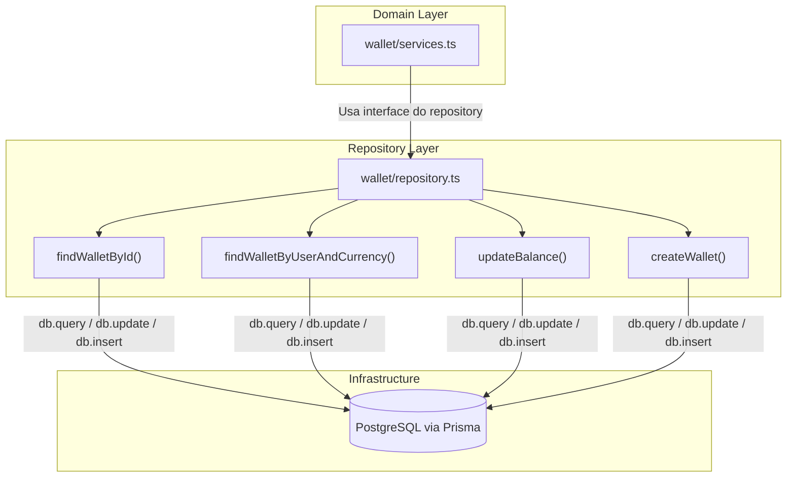

### Exemplo — Repository de Wallets

```typescript
// src/domains/wallet/repository.ts

import { db } from '@/lib/db';
import type { Wallet } from '@/generated/prisma/client';

// ─── Queries ────────────────────────────────────────────────────────────────

export const findWalletById = async (id: string): Promise<Wallet | null> => {
    return db.wallet.findUnique({ where: { id } });
};

export const findWalletByUserAndCurrency = async (
    userId: string,
    currency: string,
): Promise<Wallet | null> => {
    const result = await db.query.wallets.findFirst({
        where: and(
            eq(wallets.userId, userId),
            eq(wallets.currency, currency),
        ),
    });
    return result ?? null;
};

// ─── Mutations ──────────────────────────────────────────────────

export const updateBalance = async (
    walletId: string,
    newBalance: string,
): Promise<void> => {
    await db.update(wallets)
        .set({ balance: newBalance, updatedAt: new Date() })
        .where(eq(wallets.id, walletId));
};

export const createWallet = async (
    data: Omit<Wallet, 'id' | 'createdAt' | 'updatedAt'>,
): Promise<Wallet> => {
    const [wallet] = await db.insert(wallets)
        .values(data)
        .returning();
    return wallet!;
};
```

### Quando usar

- ✅ Isolar o domínio de detalhes de persistência (Drizzle, Prisma, raw SQL)
- ✅ Facilitar testes unitários com mock do repository
- ❌ Para CRUDs triviais sem lógica de negócio — o overhead pode não compensar

---

## 6. Adapter

**Categoria:** Structural  
**Problema:** APIs externas têm interfaces diferentes, mas o domínio precisa de uma interface uniforme.  
**Solução:** Um "adaptador" que traduz a interface externa para a interface esperada pelo domínio.

> **Onde usamos:** `ExchangeProvider` interface unifica Mercado Bitcoin, Foxbit etc. `PaymentProvider` unifica Brasil Cash, StarkBank.

### Diagrama

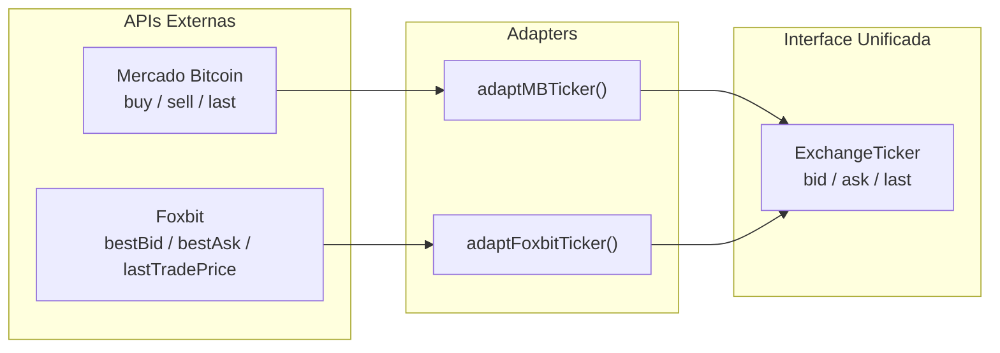

### Exemplo — Adapter para normalizar respostas de provedores de câmbio

```typescript
// src/domains/exchange/types.ts (interface do domínio)
export interface ExchangeTicker {
    bid: string;
    ask: string;
    last: string;
}

// ─── Adapter Mercado Bitcoin ────────────────────────────────────
// src/infrastructure/integrations/exchanges/mercado-bitcoin/adapter.ts

interface MBTickerRaw {
    buy: string;
    sell: string;
    last: string;
    date: number;
    vol: string;
}

export const adaptMBTicker = (raw: MBTickerRaw): ExchangeTicker => ({
    bid: raw.buy,    // MB chama de "buy"
    ask: raw.sell,   // MB chama de "sell"
    last: raw.last,
});

// ─── Adapter Foxbit ─────────────────────────────────────────────
// src/infrastructure/integrations/exchanges/foxbit/adapter.ts

interface FoxbitTickerRaw {
    bestBid: string;
    bestAsk: string;
    lastTradePrice: string;
}

export const adaptFoxbitTicker = (raw: FoxbitTickerRaw): ExchangeTicker => ({
    bid: raw.bestBid,
    ask: raw.bestAsk,
    last: raw.lastTradePrice,
});
```

### Quando usar

- ✅ Integrar APIs externas com interfaces diferentes
- ✅ Normalizar respostas para um formato de domínio único
- ❌ Quando a API externa já está na interface desejada

---

## 7. Facade

**Categoria:** Structural  
**Problema:** Um subsistema complexo com muitos módulos internos precisa de uma interface simplificada para consumidores externos.  
**Solução:** Um módulo de fachada que expõe apenas a API pública, escondendo a complexidade interna.

> **Onde usamos:** Todo `index.ts` (barrel export) em nossos domínios funciona como Facade. Ex.: `src/domains/webhook/index.ts`.

### Diagrama

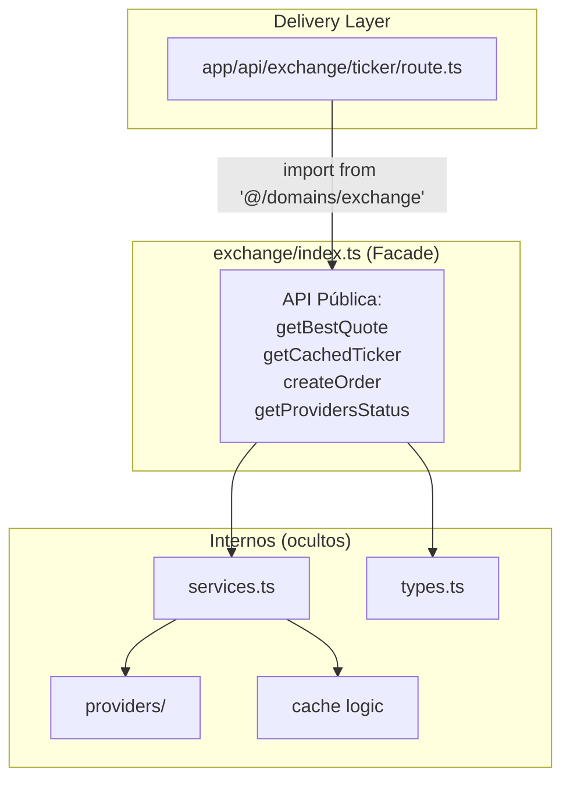

### Exemplo — Facade do domínio Exchange

```typescript
// src/domains/exchange/index.ts

/**
 * Exchange Domain — Public API (Facade)
 *
 * Consumers importam APENAS daqui.
 * Detalhes internos (providers, cache, DB) ficam ocultos.
 */

// Types
export type {
    ExchangePair,
    ExchangeProvider,
    ExchangeTicker,
    QuoteData,
} from './types';

// Services — API pública do domínio
export {
    createOrder,
    getActiveProvider,
    getBestQuote,
    getCachedTicker,
    getOrderStatus,
    getProvidersStatus,
} from './services';
```

```typescript
// Consumidor — src/app/api/exchange/ticker/route.ts
import { getCachedTicker } from '@/domains/exchange';
//       ^ usa a Facade, não importa de './services' diretamente
```

### Quando usar

- ✅ Sempre — cada domínio deve ter um `index.ts` como API pública
- ✅ Reduzir acoplamento entre camadas (App → Domain)
- ❌ Nunca exporte internals diretamente. Tudo passa pela Facade

---

## 8. Observer / Pub-Sub

**Categoria:** Behavioral  
**Problema:** Módulos precisam reagir a eventos sem acoplamento direto entre emissor e receptor.  
**Solução:** Um mecanismo de publicar/assinar eventos, onde o emissor não conhece os assinantes.

> **Onde usamos:** **Inngest** events (ex.: `step.sendEvent()`), **Pusher** para notificações realtime.

### Diagrama

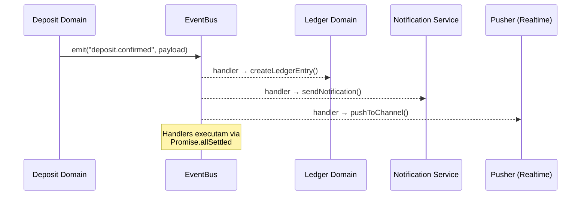

### Exemplo — Event Bus tipado para eventos de domínio

```typescript
// src/shared/events/event-bus.ts

type EventHandler<T = unknown> = (payload: T) => Promise<void>;

const handlers = new Map<string, EventHandler[]>();

export const DOMAIN_EVENTS = {
    DEPOSIT_CONFIRMED: 'deposit.confirmed',
    WITHDRAWAL_COMPLETED: 'withdrawal.completed',
    EXCHANGE_ORDER_FILLED: 'exchange.order.filled',
    KYC_APPROVED: 'kyc.approved',
} as const;

type DomainEvent = (typeof DOMAIN_EVENTS)[keyof typeof DOMAIN_EVENTS];

export const on = <T>(event: DomainEvent, handler: EventHandler<T>): void => {
    const existing = handlers.get(event) ?? [];
    existing.push(handler as EventHandler);
    handlers.set(event, existing);
};

export const emit = async <T>(event: DomainEvent, payload: T): Promise<void> => {
    const eventHandlers = handlers.get(event) ?? [];
    await Promise.allSettled(
        eventHandlers.map((handler) => handler(payload)),
    );
};
```

```typescript
// Subscriber — src/domains/ledger/listeners.ts
import { DOMAIN_EVENTS, on } from '@/shared/events/event-bus';

on<{ userId: string; amount: string }>(DOMAIN_EVENTS.DEPOSIT_CONFIRMED, async (payload) => {
    // Criar lançamento no ledger
    await createLedgerEntry({
        userId: payload.userId,
        amount: payload.amount,
        type: 'CREDIT',
    });
});
```

### Quando usar

- ✅ Desacoplar domínios (ex.: deposit confirma → ledger registra → notificação envia)
- ✅ Inngest `step.sendEvent()` é uma implementação Pub-Sub distribuída
- ❌ Quando a relação é direta e síncrona (chamada de função é mais simples)

---

## 9. Builder

**Categoria:** Creational  
**Problema:** Construção de objetos complexos com muitas opções ou etapas.  
**Solução:** Encadear chamadas de método para construir o objeto passo a passo.

### Diagrama

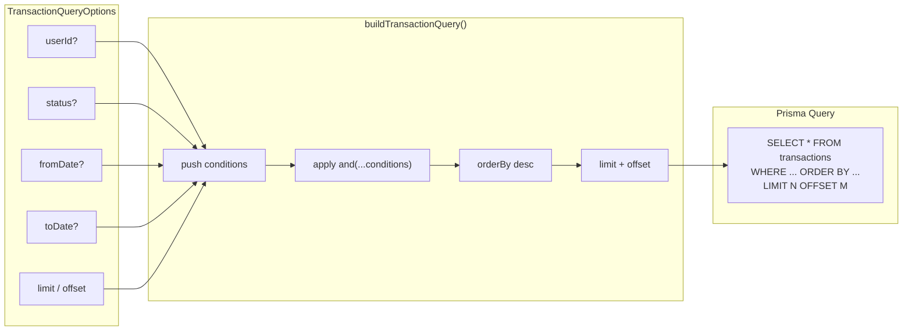

### Exemplo — Builder de queries de transações

```typescript
// src/domains/transaction/query-builder.ts

import { db } from '@/lib/db';
import type { Prisma } from '@/generated/prisma/client';

interface TransactionQueryOptions {
    userId?: string;
    status?: string;
    fromDate?: Date;
    toDate?: Date;
    limit?: number;
    offset?: number;
}

export const buildTransactionQuery = (opts: TransactionQueryOptions) => {
    const where: Prisma.TransactionWhereInput = {};

    if (opts.userId) where.userId = opts.userId;
    if (opts.status) where.status = opts.status;
    if (opts.fromDate || opts.toDate) {
        where.createdAt = {
            ...(opts.fromDate && { gte: opts.fromDate }),
            ...(opts.toDate && { lte: opts.toDate }),
        };
    }

    return db.transaction.findMany({
        where,
        orderBy: { createdAt: 'desc' },
        take: opts.limit ?? 50,
        skip: opts.offset ?? 0,
    });
};

// Uso:
// const txs = await buildTransactionQuery({ userId: '123', status: 'COMPLETED', limit: 10 });
```

### Quando usar

- ✅ Queries dinâmicas com filtros opcionais
- ✅ Construção de objetos com muitos parâmetros opcionais
- ❌ Quando o objeto é simples (2-3 campos)

---

## 10. Decorator / Higher-Order Function

**Categoria:** Structural  
**Problema:** Adicionar comportamento (logging, cache, retry, rate limit) a funções existentes sem modificá-las.  
**Solução:** Envolver a função original com outra que adiciona o comportamento desejado.

### Diagrama

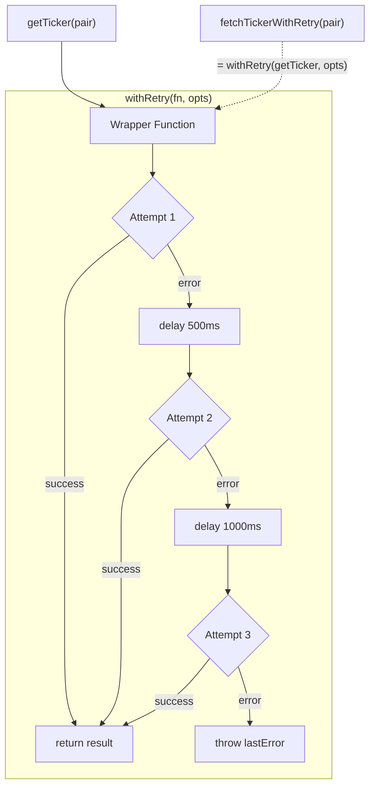

### Exemplo — Decorator de retry para chamadas de API

```typescript
// src/shared/utils/with-retry.ts

interface RetryOptions {
    maxAttempts: number;
    delayMs: number;
    backoffMultiplier?: number;
}

export const withRetry = <TArgs extends unknown[], TResult>(
    fn: (...args: TArgs) => Promise<TResult>,
    opts: RetryOptions,
) => {
    return async (...args: TArgs): Promise<TResult> => {
        let lastError: Error | undefined;
        let delay = opts.delayMs;

        for (let attempt = 1; attempt <= opts.maxAttempts; attempt++) {
            try {
                return await fn(...args);
            } catch (err) {
                lastError = err instanceof Error ? err : new Error(String(err));
                if (attempt < opts.maxAttempts) {
                    await new Promise((r) => setTimeout(r, delay));
                    delay *= opts.backoffMultiplier ?? 2;
                }
            }
        }

        throw lastError;
    };
};

// Uso no domínio:
import { withRetry } from '@/shared/utils/with-retry';

const fetchTickerWithRetry = withRetry(
    (pair: string) => externalApi.getTicker(pair),
    { maxAttempts: 3, delayMs: 500 },
);
```

### Quando usar

- ✅ Cross-cutting concerns: retry, cache, logging, timing, auth
- ✅ Reutilizar lógica transversal sem duplicação
- ❌ Quando a lógica é específica e não será reaproveitada

---

## 11. Chain of Responsibility

**Categoria:** Behavioral  
**Problema:** Uma requisição precisa passar por múltiplos processadores em sequência (validação, autenticação, rate limit, etc.).  
**Solução:** Cada handler processa ou repassa para o próximo na cadeia.

> **Onde usamos:** Middleware Next.js (`src/proxy.ts`), pipeline de validação de webhooks.

### Diagrama

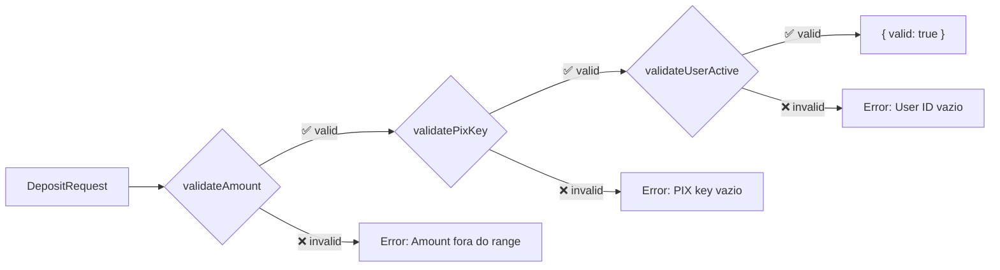

### Exemplo — Pipeline de validação de depósito

```typescript
// src/domains/deposit/validators/pipeline.ts

interface DepositRequest {
    userId: string;
    amount: number;
    pixKey: string;
}

interface ValidationResult {
    valid: boolean;
    error?: string;
}

type Validator = (req: DepositRequest) => ValidationResult;

// ─── Validators (cada "elo" da chain) ───────────────────────────

const validateAmount: Validator = (req) =>
    req.amount > 0 && req.amount <= 100_000
        ? { valid: true }
        : { valid: false, error: 'Amount must be between 1 and 100,000' };

const validatePixKey: Validator = (req) =>
    req.pixKey.length > 0
        ? { valid: true }
        : { valid: false, error: 'PIX key is required' };

const validateUserActive: Validator = (req) =>
    req.userId.length > 0
        ? { valid: true }
        : { valid: false, error: 'User ID is required' };

// ─── Pipeline Runner ────────────────────────────────────────────

const DEPOSIT_VALIDATORS: Validator[] = [
    validateAmount,
    validatePixKey,
    validateUserActive,
];

export const validateDeposit = (req: DepositRequest): ValidationResult => {
    for (const validator of DEPOSIT_VALIDATORS) {
        const result = validator(req);
        if (!result.valid) return result;
    }
    return { valid: true };
};
```

### Quando usar

- ✅ Pipelines de validação, middleware, filtros sequenciais
- ✅ Quando a ordem de processamento importa
- ❌ Quando apenas uma validação é necessária

---

## 12. Result Pattern (Either)

**Categoria:** Functional  
**Problema:** Funções de domínio podem falhar de formas esperadas (validação, regra de negócio), mas lançar exceptions para fluxo de controle é anti-pattern.  
**Solução:** Retornar um tipo discriminado `{ success: true, data } | { success: false, error }` em vez de lançar exceções.

### Diagrama

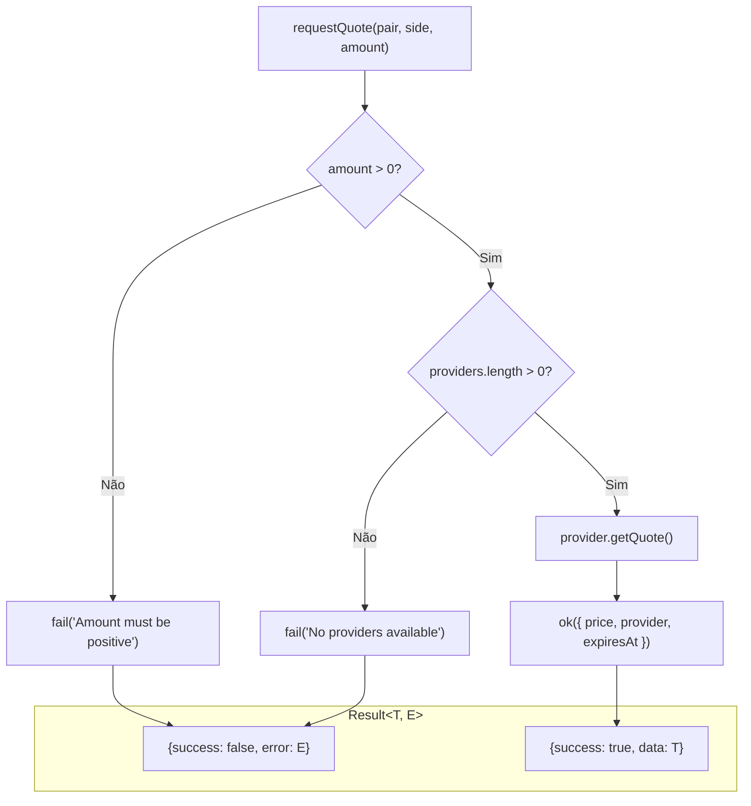

### Exemplo — Result tipo seguro

```typescript
// src/shared/types/result.ts

type Result<T, E = string> =
    | { success: true; data: T }
    | { success: false; error: E };

// ─── Helpers ────────────────────────────────────────────────────

export const ok = <T>(data: T): Result<T, never> => ({
    success: true,
    data,
});

export const fail = <E = string>(error: E): Result<never, E> => ({
    success: false,
    error,
});
```

```typescript
// src/domains/exchange/services.ts
import { ok, fail, type Result } from '@/shared/types/result';

interface QuoteResult {
    price: string;
    provider: string;
    expiresAt: Date;
}

export const requestQuote = async (
    pair: string,
    side: 'buy' | 'sell',
    amount: string,
): Promise<Result<QuoteResult>> => {
    if (parseFloat(amount) <= 0) {
        return fail('Amount must be positive');
    }

    const providers = getActiveProviders();
    if (providers.length === 0) {
        return fail('No exchange providers available');
    }

    const quote = await providers[0]!.getQuote(pair, side, amount);

    return ok({
        price: quote.price!,
        provider: quote.provider!,
        expiresAt: new Date(Date.now() + 30_000),
    });
};

// Consumidor:
const result = await requestQuote('BTC-BRL', 'buy', '1000');
if (!result.success) {
    // TypeScript sabe que result.error existe aqui
    log.warn({ error: result.error }, 'Quote failed');
    return;
}
// TypeScript sabe que result.data existe aqui
console.log(result.data.price);
```

### Quando usar

- ✅ Funções de domínio onde falhas são **esperadas** (validação, regras)
- ✅ Eliminar try/catch para fluxo de controle
- ❌ Erros inesperados (bugs, infra down) — esses devem ser exceptions

---

## 13. Value Object

**Categoria:** DDD  
**Problema:** Tipos primitivos (`string`, `number`) não carregam semântica de domínio — um `userId` e um `walletId` são ambos `string`, mas não intercambiáveis.  
**Solução:** Criar tipos "branded" que adicionam semântica sem overhead em runtime.

### Diagrama

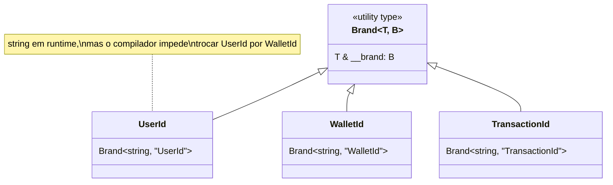

### Exemplo — Branded types para IDs de domínio

```typescript
// src/shared/types/branded.ts

declare const __brand: unique symbol;

type Brand<T, B extends string> = T & { readonly [__brand]: B };

// ─── Domain IDs ──────────────────────────────────────────────────

export type UserId = Brand<string, 'UserId'>;
export type WalletId = Brand<string, 'WalletId'>;
export type TransactionId = Brand<string, 'TransactionId'>;
export type QuoteId = Brand<string, 'QuoteId'>;

// ─── Constructors (validação no ponto de criação) ────────────────

export const UserId = (raw: string): UserId => {
    if (!raw || raw.length === 0) throw new Error('UserId cannot be empty');
    return raw as UserId;
};

export const WalletId = (raw: string): WalletId => {
    if (!raw || raw.length === 0) throw new Error('WalletId cannot be empty');
    return raw as WalletId;
};
```

```typescript
// Uso no domínio — type safety sem overhead
import type { UserId, WalletId } from '@/shared/types/branded';

const getWalletBalance = async (userId: UserId, walletId: WalletId): Promise<string> => {
    // userId e walletId são strings em runtime, mas o compilador
    // impede que você passe um WalletId onde esperava um UserId
    return '1000.00';
};

// ❌ Compile error: Argument of type 'WalletId' is not assignable to parameter of type 'UserId'
// getWalletBalance(walletId, userId);
```

### Quando usar

- ✅ IDs de entidades (evitar `string` genérico)
- ✅ Valores monetários, percentuais, unidades
- ❌ Para dados temporários ou internos de uma única função

---

## 14. Module Pattern (Barrel Export)

**Categoria:** Structural  
**Problema:** Consumidores precisam importar de múltiplos arquivos internos, criando acoplamento.  
**Solução:** Um `index.ts` que re-exporta a API pública do módulo.

> **Onde usamos:** Todos os domínios (`src/domains/*/index.ts`), infrastructure modules.

### Diagrama

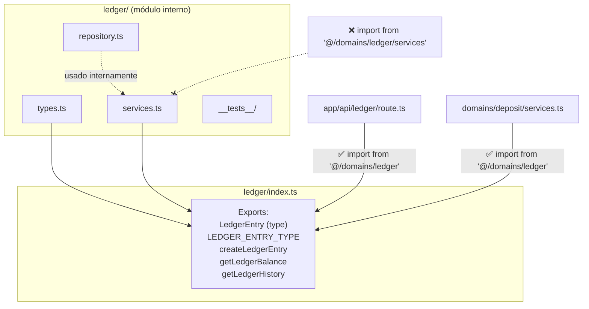

### Exemplo — Barrel export de domínio

```typescript
// src/domains/ledger/index.ts

/**
 * Ledger Domain — Public API
 */

// Types
export type {
    LedgerEntry,
    LedgerEntryType,
} from './types';

export { LEDGER_ENTRY_TYPE } from './types';

// Services
export {
    createLedgerEntry,
    getLedgerBalance,
    getLedgerHistory,
} from './services';
```

**Regra:** Consumidores **SEMPRE** importam do barrel:

```typescript
// ✅ Correto
import { createLedgerEntry } from '@/domains/ledger';

// ❌ Proibido — importar arquivo interno
import { createLedgerEntry } from '@/domains/ledger/services';
```

### Quando usar

- ✅ **Sempre** — todo módulo/domínio deve ter um barrel export
- ✅ Controla a superfície pública da API do módulo
- ❌ Cuidado com circular dependencies em árvores grandes

---

## Mapa de Decisão Rápida

```
Qual problema tenho?
│
├── Preciso criar objetos de formas variadas?
│   ├── Muitas variações        → Factory (§3)
│   ├── Registro dinâmico       → Registry (§2)
│   ├── Instância única global  → Singleton (§4)
│   └── Construção em etapas    → Builder (§9)
│
├── Preciso estruturar relações?
│   ├── Interface externa ≠ interna  → Adapter (§6)
│   ├── Simplificar API complexa     → Facade (§7)
│   ├── Isolar persistência          → Repository (§5)
│   └── Modularizar exports          → Barrel (§14)
│
├── Preciso variar comportamento?
│   ├── Algoritmos intercambiáveis   → Strategy (§1)
│   ├── Pipeline de processamento    → Chain of Resp. (§11)
│   ├── Reagir a eventos             → Observer (§8)
│   └── Adicionar behavior           → Decorator (§10)
│
└── Preciso de type safety funcional?
    ├── Evitar exceptions de fluxo   → Result Pattern (§12)
    └── Semântica em primitivos      → Value Object (§13)
```

---

## Referências

| Fonte | URL |
|-------|-----|
| Refactoring Guru — Design Patterns | https://refactoring.guru/design-patterns |
| patterns.dev — Modern JS Patterns | https://www.patterns.dev/ |
| LogRocket — TypeScript Design Patterns | https://blog.logrocket.com/design-patterns-in-typescript/ |
| SOLID Principles — Strapi | https://strapi.io/blog/solid-design-principles |
| Node.js Best Practices 2025 | https://github.com/goldbergyoni/nodebestpractices |

---

> **Última atualização:** 2026-03-13
