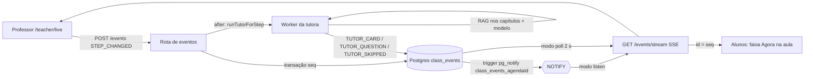

# Aula como sequência de eventos e tutora proativa — Design

Data: 2026-11-08
Status: aprovado em conversa (seção a seção), aguardando plano de implementação

## 0. Contexto e objetivo

Hoje a tutora só reage: o aluno pergunta no chat e ela responde. A aula não tem "posição": início e fim vêm do relógio (`deriveAgendaStatus` em `src/domains/agendas/agenda-validator.ts`), o professor só encerra ou cancela (`PATCH /api/v1/agendas/[id]/status`), não existe página de sala ao vivo para ele, e a sala do aluno (`src/app/(student)/classroom/[sessionId]/_components/ClassroomPage.tsx`) vive de um relógio de 60 s e da FAQ recarregada a cada 30 s (`useAgendaFaqs` em `src/components/classroom/use-agenda-lesson.ts`). Não há canal push: o chat (`src/app/api/v1/agent/chat/stream/route.ts`, `src/components/ai/use-tutor-chat.ts`) é SSE por requisição, e o único comportamento proativo (`checkStalemate` em `src/domains/agendas/services/study-group-service.ts`) depende de polling de 5 s e de um `Map` em memória do processo.

Este design transforma a aula numa sequência imutável de eventos e faz a tutora agir sozinha a cada passo do roteiro.

- **Fonte de verdade da posição:** o roteiro `LessonPlan.timeScript` (`timeScriptSchema` em `src/domains/teaching/time-script.ts`), avançado pelo professor. A tutora nunca decide em que ponto a aula está.
- **Áudio fora do escopo:** `next.config.mjs` bloqueia `microphone=()` na `Permissions-Policy`, coerente com a tese de privacidade do produto. Nada aqui ouve a sala.

Objetivos de produto:

1. O professor conduz a aula por uma tela própria e a turma vê o passo atual sem recarregar.
2. A cada passo, a tutora publica um cartão curto com conceitos citados do material e, quando cabe, uma pergunta de verificação opcional.
3. O professor vê, sem nomes, quantos responderam e a taxa de acerto.

Objetivos de portfólio: modelo de eventos com cursor e idempotência, SSE com retomada por `Last-Event-ID` sob limite de plataforma serverless, LISTEN/NOTIFY do Postgres como alternativa ao polling, worker de IA com política de silêncio explícita e evals próprios.

Fora do escopo: áudio e transcrição; presença automática; ata coletiva da turma (a `PedagogicalMinute` continua por aluno); entrega sub-segundo na Vercel.

## 1. Modelo de dados

### `ClassEvent`

```prisma
enum ClassEventType {
  STEP_CHANGED
  TUTOR_CARD
  TUTOR_QUESTION
  TEACHER_NOTE
  SESSION_STARTED
  SESSION_ENDED
  TUTOR_SKIPPED
}

enum ClassEventActor {
  TEACHER
  TUTOR
  SYSTEM
}

model ClassEvent {
  id        String          @id @default(cuid())
  agendaId  String
  seq       Int
  type      ClassEventType
  stepIndex Int?
  payload   Json
  audience  String          // "ALL" | "TEACHER" | <studentId>
  createdBy ClassEventActor
  createdAt DateTime        @default(now())

  agenda Agenda @relation(fields: [agendaId], references: [id], onDelete: Cascade)

  @@unique([agendaId, seq])
  @@map("class_events")
}
```

- `Agenda` ganha `events ClassEvent[]`. Nenhum campo novo na `Agenda`: a posição atual é o último `STEP_CHANGED` visível ao leitor (maior `seq`).
- **Imutável:** o repositório só expõe `insert` e consultas. Correção é um evento novo (voltar um passo é outro `STEP_CHANGED`).
- `seq` é inteiro crescente por agenda e serve de cursor. O `@@unique([agendaId, seq])` é também o índice de leitura `(agendaId, seq)`.
- **Idempotência da tutora:** índice único parcial escrito à mão na migration, porque o Prisma não expressa `WHERE`:
  `CREATE UNIQUE INDEX class_events_tutor_step_uq ON class_events ("agendaId", "stepIndex", type) WHERE type IN ('TUTOR_CARD','TUTOR_QUESTION');`
- Migration criada com `prisma migrate dev --create-only` e revisada antes de aplicar: o drift do pgvector gera `DROP`s espúrios que devem ser removidos do SQL.

**Geração do `seq` em concorrência.** Escolha: transação que trava a linha da agenda e lê o máximo.

```sql
SELECT id FROM agendas WHERE id = $1 FOR UPDATE;
SELECT COALESCE(MAX(seq), 0) + 1 FROM class_events WHERE "agendaId" = $1;
INSERT INTO class_events (...) VALUES (...);
```

Justificativa: não cria tabela nem coluna (a `Agenda` fica sem estado de aula), a trava serializa só escritores da mesma agenda, o volume é baixo (dezenas de eventos por aula) e o `MAX` usa o índice `(agendaId, seq)`. O `@@unique([agendaId, seq])` é a rede de segurança: violação (P2002) é repetida uma vez. Uma tabela de contador exigiria a mesma trava e mais um objeto para manter.

### Payloads (Zod por tipo, em `src/domains/classroom/class-event-schema.ts`)

`parseClassEvent(type, payload)` valida na escrita e na leitura; payload inválido na leitura é descartado com log, nunca derruba o stream.

| Tipo | Autor / audience | Payload | Limites |
|---|---|---|---|
| `SESSION_STARTED` | TEACHER / ALL | `{}` | — |
| `STEP_CHANGED` | TEACHER ou SYSTEM / ALL (aula ao vivo) ou `studentId` (aula gravada) | `{ activity, timeRange, fromStepIndex, videoSeconds? }` | `activity` 1..200; `timeRange` 0..40; `fromStepIndex` int ≥ 0 ou `null`; `videoSeconds` int ≥ 0; coluna `stepIndex` 0..59 (`TIME_SCRIPT_MAX_ITEMS`) e dentro do roteiro |
| `TUTOR_CARD` | TUTOR / ALL | `{ concepts: [{ title, explanation, citation: { chunkId, label, page } }], objectiveLink, source }` | 2..3 conceitos; `title` 1..80; `explanation` 1..400; `label` 1..200 (formato de `formatChapterLabel`); `page` int ≥ 1 ou `null`; `objectiveLink` 1..300; `source` `GENERATED` ou `DRAFT` |
| `TUTOR_QUESTION` | TUTOR / ALL | `{ kind: 'MULTIPLE_CHOICE', question, origin: 'TUTOR', source }` ou `{ kind: 'OPEN', text, origin: 'TEACHER' }` | `question` = `questionSchema` (`src/domains/assessments/question-schema.ts`: 4 alternativas, `rationale`); `text` 1..500 |
| `TEACHER_NOTE` | TEACHER / TEACHER | `{ tutor: 'MUTE' \| 'UNMUTE' \| 'PUBLISH_NOW' \| null, scope: 'STEP' \| 'LESSON', text? }` | `text` 0..500; `scope: 'STEP'` exige coluna `stepIndex` |
| `TUTOR_SKIPPED` | TUTOR / TEACHER | `{ reason: 'NO_MATERIAL' \| 'RATE_LIMIT' \| 'BUDGET' \| 'PROVIDER_ERROR', kind: 'CARD' \| 'QUESTION' \| 'BOTH' }` | — |
| `SESSION_ENDED` | TEACHER / ALL | `{}` | — |

Projeção para o aluno: `TUTOR_QUESTION` de múltipla escolha sai sem `correctKey` e `rationale` (mesma regra de `PublicQuestion`); ambos só voltam na resposta da rota de resposta.

### Tabelas existentes

- `StudentInteraction` e `PedagogicalMinute` não mudam.
- `InferenceLog` ganha `agendaId String?` e `purpose InferencePurpose?` (`enum InferencePurpose { CHAT TUTOR_CARD TUTOR_QUESTION }`), com `@@index([agendaId])`. `createLoggedStreamChat` (`src/domains/telemetry/services/logged-stream-chat.ts`) aceita esses dois campos opcionais; o chat da tutora passa `CHAT`, o worker passa `TUTOR_CARD` ou `TUTOR_QUESTION`. Chamadas antigas ficam com `null`.

### `TutorStepDraft`

```prisma
model TutorStepDraft {
  id           String   @id @default(cuid())
  lessonPlanId String
  stepIndex    Int
  stepHash     String              // sha256 de activity + description + socraticQuestion + capítulos da aula
  card         Json?               // payload de TUTOR_CARD já validado
  question     Json?               // payload de TUTOR_QUESTION já validado
  calls        Int      @default(0) // chamadas ao modelo gastas neste passo (teto 2)
  claimedAt    DateTime?
  updatedAt    DateTime @updatedAt
  lessonPlan LessonPlan @relation(fields: [lessonPlanId], references: [id], onDelete: Cascade)
  @@unique([lessonPlanId, stepIndex])
  @@map("tutor_step_drafts")
}
```

Escolha por tabela, não campo JSON no `LessonPlan`: (a) o rascunho é escrito pelo worker enquanto o professor pode estar editando a aula, e um JSON no `LessonPlan` faria um sobrescrever o outro e mexeria em `updatedAt`; (b) a linha por passo serve de **reserva** (`claimedAt`) e de **contador de custo** (`calls`) com `UPDATE ... WHERE` atômico, o que um JSON não dá; (c) `stepHash` invalida só o passo editado. Como `Agenda.lessonPlanId` é único, o rascunho da aula é o rascunho da agenda.

## 2. Canal



### Leitura

- `GET /api/v1/agendas/[id]/events?after=<seq>`: JSON `{ events, lastSeq }`, até 200 eventos por página.
- `GET /api/v1/agendas/[id]/events/stream?after=<seq>`: `text/event-stream`. Cada evento sai com `id: <seq>`, `event: <type>` e `data: <json>`. A primeira linha é `retry: 1000`. O cursor é o maior entre `after` e o cabeçalho `Last-Event-ID`.
- **Escopo:** a agenda é carregada pelo escopo que já existe (`loadInScope` em `agenda-service.ts`: aluno da turma, professor dono da disciplina ou da agenda, admin). Fora do escopo dá 404.
- **Audience na consulta:** aluno lê `audience IN ('ALL', <seu id>)`; professor e admin leem `ALL` e `TEACHER`. O filtro está no `WHERE` do repositório, nunca no cliente.
- **Fechamento limpo:** `CLASS_EVENTS_STREAM_MAX_MS` define quanto a conexão vive; padrão 8000 quando `VERCEL` está definido e `0` (sem limite) fora dela, em Docker ou VPS. Ao atingir o limite, o servidor envia o que tiver, fecha o stream e o `EventSource` reconecta com `Last-Event-ID`. Sem limite, o servidor manda o comentário `: ping` a cada 25 s.

### Descoberta de eventos novos (`CLASS_EVENTS_NOTIFY_MODE`)

- `poll` (padrão): cada conexão consulta `seq > cursor` a cada 2 s.
- `listen`: trigger `AFTER INSERT` em `class_events` chama `pg_notify('class_events_' || "agendaId", NEW.seq::text)`. O trigger existe nos dois modos (custo desprezível sem ouvintes). Um ouvinte por processo (`src/domains/classroom/class-event-listener.ts`, cliente `pg` dedicado, porque o Prisma não faz `LISTEN`) assina o canal da agenda enquanto houver conexão aberta para ela e acorda essas conexões. A notificação é só um despertador: a conexão sempre relê do banco a partir do cursor, então perder uma notificação ou reiniciar o processo não perde evento. Se o ouvinte cair, a conexão volta a consultar a cada 2 s até ele reconectar.

### Cliente: `useClassEvents(agendaId)`

Em `src/components/classroom/use-class-events.ts`. Devolve `{ events, status: 'live' | 'updating' | 'offline', lastSeq }`.

- Abre `EventSource` no stream. Se não houver conexão aberta por 10 s seguidos, troca para polling de 5 s em `GET /events?after=`; a cada 30 s em polling tenta o SSE de novo e, se abrir, para o polling.
- Deduplica por `seq` e mantém a lista ordenada. Todo estado de tela sai de funções puras sobre essa lista (seção 4).
- Na `ClassroomPage`, substitui o `setInterval` de 60 s: o status passa a ser recalculado a cada `SESSION_STARTED`/`SESSION_ENDED` e por um único `setTimeout` agendado para o próximo limite (`startTime` ou `endTime`), sem tique periódico. Substitui também o polling de 30 s de `useAgendaFaqs`: a FAQ recarrega a cada evento recebido e ao fim de cada resposta do chat do próprio aluno.
- O grupo de estudos migra na entrega 4.

### Escrita

`POST /api/v1/agendas/[id]/events`, body `{ type, stepIndex?, payload }`:

- Só o professor dono da agenda (`agenda.teacherId` ou disciplina dele) ou admin; aluno recebe 403.
- Só `STEP_CHANGED`, `TEACHER_NOTE`, `SESSION_STARTED`, `SESSION_ENDED`. Qualquer outro tipo dá 400 `EVENT_TYPE_NOT_ALLOWED`; eventos da tutora nascem só no servidor.
- `STEP_CHANGED` antes de `SESSION_STARTED` dá 409 `CLASS_NOT_STARTED`; qualquer escrita depois de `SESSION_ENDED` dá 409 `CLASS_ENDED`. `stepIndex` fora do roteiro dá 400 `STEP_OUT_OF_RANGE`. O servidor preenche `activity` e `timeRange` a partir do `timeScript`; o cliente manda só `stepIndex`.
- `SESSION_STARTED` grava, na mesma transação, `STEP_CHANGED` para o passo 0.
- `SESSION_ENDED` grava o evento, chama `setAgendaStatus(COMPLETED)` e `generateMinutesForAgenda` (`src/domains/pedagogy/services/minutes-service.ts`) como o `PATCH .../status` faz hoje; falha nas atas não desfaz o evento.

## 3. Worker da tutora

`runTutorForStep(agendaId, stepIndex, deps)` em `src/domains/classroom/tutor-step-worker.ts`. Sem estado em memória.

**Disparo.**

1. Depois de gravar `STEP_CHANGED` (pelo professor ou pela rota `video-step`) ou `TEACHER_NOTE` com `PUBLISH_NOW`, a rota responde e agenda o worker com `after()` de `next/server`.
2. Sob demanda: quando `GET /events` ou o stream entregam um `STEP_CHANGED` cujo passo não tem `TUTOR_CARD`, `TUTOR_QUESTION` nem `TUTOR_SKIPPED` e o evento tem mais de 20 s, a rota agenda o worker do mesmo jeito. Isso recupera um worker morto pelo limite da plataforma. A reserva e o índice único evitam trabalho duplicado.

**Reserva e custo.** O worker faz upsert da linha `TutorStepDraft` do passo e tenta `UPDATE ... SET "claimedAt" = now() WHERE id = $1 AND calls < 2 AND ("claimedAt" IS NULL OR "claimedAt" < now() - interval '60 seconds')`. Zero linhas afetadas: outro worker está no passo ou o teto acabou, e ele sai. Cada chamada ao modelo incrementa `calls` antes de ser feita. Teto: **2 chamadas por passo por aula**, contando pré-geração, geração ao vivo e falhas; o retry único em 429 do `AIProviderGateway` (`src/lib/ai-provider.ts`) é parte da mesma chamada.

**Política de silêncio**, avaliada em `decideTutorPlan(step, context)`, função pura em `src/domains/classroom/tutor-policy.ts`. As regras estão numeradas pela ordem de avaliação:

1. `TEACHER_NOTE` com `tutor: 'MUTE'` para a aula, ou para o passo, sem `UNMUTE`/`PUBLISH_NOW` posterior: nada é gerado nem publicado. `PUBLISH_NOW` anula o `MUTE` só daquele passo.
2. Se o passo tem `socraticQuestion`, a pergunta publicada é a do professor (`kind: 'OPEN'`, `origin: 'TEACHER'`) sem chamada ao modelo.
3. Passo com menos de 4 minutos no `timeScript` (`timeSeconds` do próximo passo menos o deste; no último, `endTime - startTime` da agenda menos `timeSeconds`) não ganha pergunta gerada.
4. Sem trecho recuperado: sem cartão e sem pergunta gerada; grava `TUTOR_SKIPPED { reason: 'NO_MATERIAL' }` com audience `TEACHER`. A pergunta do professor (regra 2) ainda sai.
5. Duas chamadas seguidas do passo terminadas em `fallbackReason === 'rate_limit'`: o passo é pulado com `TUTOR_SKIPPED { reason: 'RATE_LIMIT' }` e o painel mostra o aviso. Teto atingido por outra causa grava `BUDGET` ou `PROVIDER_ERROR`.

**Cartão (`TUTOR_CARD`).** Escopo = capítulos da aula expandidos (`expandChapterScope` em `src/domains/rag/services/chapter-scope.ts`). Consulta = `description` do passo (ou `activity` se vazia), `executeHybridSearch` com `allowedChapterIds` e `topK: 3`. Prompt novo `src/domains/agents/prompts/tutor-card-prompt.ts` pede JSON com 2 a 3 conceitos, cada um com o `chunkId` usado, e uma frase ligando o passo ao `dailyObjective`. Cada `explanation` passa por `stripUnsupportedReferences` (`citation-guard.ts`) e `toPlainText` (`plain-text.ts`); conceito com `chunkId` fora dos trechos recuperados é descartado; menos de 2 conceitos válidos conta como falha da chamada. A citação vem do trecho, nunca do modelo. Temperatura 0.3, `purpose: TUTOR_CARD`.

**Pergunta (`TUTOR_QUESTION`).** O núcleo de `generateQuestions` (`src/domains/assessments/services/assessment-service.ts`) é extraído para `generateQuestionsFromChunks(chunks, count, buildMessages, deps)`; o caminho da avaliação passa a chamá-lo sem mudar comportamento. O worker chama com os mesmos trechos do cartão, `count = 1` e o prompt de aula `src/domains/agents/prompts/lesson-question-prompt.ts` (passo, objetivo do dia, trechos). Saída validada por `questionSchema`: 4 alternativas e `rationale`. A tutora não usa `buildFallbackQuestions`: sem resposta válida do modelo, o passo fica sem pergunta.

**Pré-geração ("Preparar tutora").** Botão no editor da aula (`LessonEditor.tsx`), habilitado quando a aula está publicada. O cliente percorre os passos chamando `POST /api/v1/teacher/lessons/[id]/tutor-drafts` com `{ stepIndex }`, um por requisição (cabe no limite de 10 s), e mostra o progresso. A rota aplica a mesma política, reserva e teto e grava `card`/`question` no `TutorStepDraft` com o `stepHash` atual. Ao vivo, o worker com rascunho de `stepHash` igual só promove para evento (`source: 'DRAFT'`) sem chamar o modelo; `stepHash` diferente zera `calls` e regenera.

**Resposta do aluno.** `POST /api/v1/agendas/[id]/events/[seq]/answer`, body `{ optionKey }` ou `{ text }` (1..1000). Só aluno da turma, só para evento `TUTOR_QUESTION` visível a ele, uma resposta por aluno por evento (segunda dá 409 `ALREADY_ANSWERED`). Grava `StudentInteraction` com `type: SOCRATIC_CHALLENGE`, `isSocraticChallenge: true`, `questionText` = enunciado, `responseText` = alternativa ou texto, `wasCorrect` = comparação com `correctKey` (múltipla escolha) ou `null` (aberta), `timestampInVideo` quando houver vídeo. Devolve `{ wasCorrect, correctKey, rationale }`. A unicidade e o pulso usam a mesma chave: `agendaId`, `studentId`, `isSocraticChallenge`, `questionText` e `createdAt >=` o `createdAt` do evento.

**Aula gravada.** Quando a agenda não tem `SESSION_STARTED` do professor e a aula tem vídeo, `interactive-video-player.tsx` chama `POST /api/v1/agendas/[id]/events/video-step` com `{ videoSeconds }` sempre que o tempo cruza um `timeSeconds` do roteiro. O servidor calcula o passo e grava `STEP_CHANGED` com `createdBy: SYSTEM` e audience = o próprio aluno, sem repetir o passo corrente dele. A exigência de `SESSION_STARTED` vale só para o `POST /events` do professor; com `SESSION_STARTED` do professor gravado, a rota `video-step` responde 409 `LIVE_CLASS_IN_PROGRESS`. Os eventos da tutora continuam por passo e com audience `ALL`; cada aluno vê os do seu passo atual.

**Evals.** Nova categoria `proativo` com 10 casos em `evals/cases/proativo.jsonl`. O cliente do harness ganha login de professor: inicia a aula seedada, grava `STEP_CHANGED` e, como aluno, lê `GET /events?after=` até o evento da tutora ou 60 s. Graders: cartão cita material e capítulo esperados, 2 a 3 conceitos, sem markdown; pergunta com 4 alternativas e sem gabarito na projeção do aluno; passo fora do material produz `TUTOR_SKIPPED NO_MATERIAL` e nenhum cartão; passo curto não tem pergunta gerada; passo com `socraticQuestion` publica a do professor. O seed (`prisma/seed-data/agendas.ts`) garante na aula ao vivo um passo de cada tipo.

## 4. Interface

### Professor: `/teacher/live/[agendaId]`

Nova página em `src/app/teacher/live/[agendaId]/`, com link "Conduzir aula" em `src/app/(teacher)/reports/_components/ClassAgendasSection.tsx`, ao lado das ações de status, quando a agenda é `CLASSROOM` e está `LIVE`.

- **Roteiro:** lista dos passos com o atual em destaque; botões "Anterior" e "Próximo" e clique em qualquer passo gravam `STEP_CHANGED`. Antes de começar, um botão "Iniciar aula" grava `SESSION_STARTED`.
- **Tutora:** prévia do conteúdo do passo atual (evento publicado ou motivo do `TUTOR_SKIPPED`) e do próximo passo (rascunho, se a aula foi preparada). "Pular" grava `TEACHER_NOTE { tutor: 'MUTE', scope: 'STEP' }` para o próximo passo. "Publicar agora" aparece no passo atual quando ele não tem evento da tutora e grava `TEACHER_NOTE { tutor: 'PUBLISH_NOW' }`. Interruptor "Tutora em silêncio nesta aula" grava `MUTE`/`UNMUTE` com `scope: 'LESSON'`.
- **Pulso da turma:** por pergunta publicada, quantos responderam e a taxa de acerto, sem nomes. Vem de `GET /api/v1/agendas/[id]/pulse`, recarregado a cada evento recebido e a cada 10 s enquanto houver pergunta aberta no passo atual.
- **Encerrar aula:** confirmação e `SESSION_ENDED` (atas geradas no servidor).
- Indicador "ao vivo" / "atualizando" a partir de `status` do hook.

### Aluno: faixa "Agora na aula"

Componente `src/components/classroom/now-in-class-strip.tsx`, na `ClassroomPage` acima do chat. Vídeo, FAQ e chat continuam como estão.

- Mostra só o passo atual (`activity`); o aluno não vê o roteiro inteiro.
- Cartão da tutora com conceitos e citações; pergunta com alternativas (ou campo de texto, se aberta); após responder, feedback com acerto e `rationale` e o botão "Continuar no chat", que preenche o chat com a pergunta e a justificativa.
- A pergunta é opcional, não bloqueia nada e não vira nota.
- Sem evento de passo, a faixa não aparece. Indicador "ao vivo" / "atualizando".

### Estado derivado (funções puras)

Em `src/domains/classroom/class-state.ts`: `currentStep(events)`, `tutorContentForStep(events, stepIndex)`, `isTutorMuted(events, stepIndex)`, `sessionPhase(events)` (`NOT_STARTED`, `RUNNING`, `ENDED`), `reduceStudentView(events, answers)` e `reduceTeacherView(events, pulse)`. Os componentes não guardam estado de aula fora disso.

## 5. Custos, falhas e limites

- **Custo:** teto de 2 chamadas por passo por aula, compartilhado entre pré-geração e geração ao vivo. Uma aula de 8 passos custa no máximo 16 chamadas, independente do número de alunos. O chat do aluno não muda.
- **429:** regra atual do gateway (um retry respeitando `retry-after`); depois, a regra 5 do worker e `TUTOR_SKIPPED`.
- **Plataforma:** na Vercel o worker roda em `after()` e pode ser cortado pelo limite da função; o disparo sob demanda e a pré-geração cobrem isso. A entrega no aluno tem latência de até ~2 s no modo `poll` mais a reconexão a cada 8 s.
- **Crescimento da tabela:** dezenas de eventos por aula, só texto curto; a leitura é sempre por `(agendaId, seq)`. Nenhuma rotina de limpeza nesta entrega; os eventos somem com a agenda (`onDelete: Cascade`).
- **Concorrência:** dois professores ou duas abas avançando ao mesmo tempo: vence o `STEP_CHANGED` de maior `seq`. Worker duplicado esbarra na reserva e, em último caso, no índice único parcial (P2002 tratado como sucesso). Nada de estado de aula em memória de processo; o ouvinte do modo `listen` só acorda conexões.
- **Autorização:** escopo da agenda e audience aplicados no servidor em toda leitura; tipos da tutora não são aceitos no `POST`.
- **Privacidade:** nenhum dado novo do aluno é coletado; a resposta usa `StudentInteraction` como o chat já faz; o pulso expõe só contagens e taxa.

### Riscos

| Risco | Mitigação |
|---|---|
| Worker cortado pelo limite de 10 s da Vercel Hobby | Pré-geração por passo; disparo sob demanda após 20 s; reserva expira em 60 s |
| TPM baixo do Groq disputado com o chat | Teto por passo independe do número de alunos; pré-geração antes da aula; regra 5 |
| Cartão com citação inventada | Citação vem do `chunkId` recuperado; `citation-guard` e descarte de conceito sem trecho; evals `proativo` |
| Muitas conexões SSE abertas em Docker | Modo `listen` com um ouvinte por processo; `poll` de 2 s como padrão simples |
| FAQ menos fresca sem o polling de 30 s | Recarrega a cada evento e ao fim de cada resposta do chat; aceito no desenho |
| Unicidade da resposta por enunciado: dois passos com o mesmo enunciado | Improvável com o índice por passo; se ocorrer, o segundo vira 409 e o pulso soma os dois; registrado como limitação |
| Drift do pgvector na migration | `--create-only` e revisão manual do SQL |

## 6. Testes e ordem de entrega

**Puros:** `class-state.ts` (posição pelo maior `seq`, voltar passo, sessão encerrada, conteúdo por passo, mute e `PUBLISH_NOW`); `tutor-policy.ts` (as 5 regras e a ordem entre elas, duração do último passo); `class-event-schema.ts` (cada payload válido e inválido, limites, projeção sem gabarito).

**Serviço:** `seq` contíguo com escritas concorrentes na mesma agenda; idempotência do worker (duas execuções, um cartão); reserva e teto de 2 chamadas; autorização do `POST` (aluno 403, outro professor 404, tipo da tutora 400, estados 409); audience (aluno não lê `TEACHER` nem eventos de outro aluno); resposta única e `wasCorrect`.

**Rota de stream:** cursor por `after` e por `Last-Event-ID`, `retry: 1000`, `id` igual a `seq`, fechamento ao atingir `CLASS_EVENTS_STREAM_MAX_MS`, os dois modos de descoberta com dependências injetadas.

**Integração com Postgres real:** no padrão de `tests/e2e/full-flow.test.ts` (`DATABASE_URL_TEST`): trigger e `NOTIFY`, índice único parcial, `seq` sob concorrência, `SESSION_ENDED` gerando atas.

**Playwright:** não há config no repositório; a entrega 2 adiciona `@playwright/test` e `playwright.config.ts` apontando para a app com seed. Fluxo: professor inicia e avança; aluno recebe o passo e o cartão; aluno responde; o pulso do professor atualiza.

### Entregas

Cada entrega é publicável sozinha e é um ponto de parada limpo.

**Entrega 1 — eventos, canal e hook.** Novos: `ClassEvent` e migration com trigger e índice parcial; `src/domains/classroom/{class-event-schema,class-event-repository,class-event-service,class-state,class-event-listener}.ts`; rotas `src/app/api/v1/agendas/[id]/events/route.ts` e `events/stream/route.ts`; `src/components/classroom/use-class-events.ts`. Tocados: `ClassroomPage.tsx` (sai o relógio de 60 s), `use-agenda-lesson.ts` (sai o polling de 30 s), `prisma/schema.prisma`, `package.json` (`pg`). Aceite: dois navegadores de aluno recebem um evento gravado por `POST` em até 3 s no modo `poll`; reconexão retoma pelo `Last-Event-ID` sem perder nem repetir; nenhum `setInterval` periódico na sala; testes e typecheck verdes.

**Entrega 2 — painel do professor sem tutora.** Novos: `src/app/teacher/live/[agendaId]/` (página e componentes de roteiro e encerramento); faixa do aluno só com o passo atual; `playwright.config.ts`. Tocados: `ClassAgendasSection.tsx` (link "Conduzir aula"), `SESSION_ENDED` ligado a `setAgendaStatus` e `generateMinutesForAgenda`. Aceite: professor inicia, avança, volta e encerra; aluno vê o passo sem ver o roteiro; encerrar gera atas como o `PATCH` atual; Playwright do fluxo verde.

**Entrega 3 — tutora proativa.** Novos: `TutorStepDraft`, `InferencePurpose` e colunas em `InferenceLog`; `tutor-step-worker.ts`, `tutor-policy.ts`; prompts `tutor-card-prompt.ts` e `lesson-question-prompt.ts`; rotas `events/[seq]/answer`, `events/video-step`, `pulse` e `teacher/lessons/[id]/tutor-drafts`; `now-in-class-strip.tsx` completo; `evals/cases/proativo.jsonl` e suporte a professor no `evals/client.py`. Tocados: `assessment-service.ts` (extração de `generateQuestionsFromChunks`), `logged-stream-chat.ts`, chat da tutora (passa `purpose: CHAT` e `agendaId`), `LessonEditor.tsx` ("Preparar tutora"), `interactive-video-player.tsx`, seed. Aceite: a cada passo sai cartão citado ou `TUTOR_SKIPPED` visível só ao professor; nunca mais de 2 linhas de `InferenceLog` de tutora por passo; resposta do aluno vira `StudentInteraction` e aparece no pulso; aula preparada publica sem chamar o modelo; aula gravada avança pelo vídeo; `proativo` ≥ 0,8 com o provedor real.

**Entrega 4 — grupo de estudos por eventos.** O enum ganha `GROUP_MESSAGE` (payload `{ messageId }`, a mensagem continua em `StudyGroupMessage`). Postar mensagem grava o evento na mesma transação; a tela do grupo troca o polling de 5 s por `useClassEvents`; `checkStalemate` passa a rodar em `after()` e o `Map` `stalemateFailedAt` é substituído pela consulta ao último `TUTOR_SKIPPED { reason: 'STALEMATE_FAILED' }` da agenda (motivo acrescentado ao schema nesta entrega). Aceite: nenhum estado em memória em `study-group-service.ts`; mensagens chegam pelo canal; testes do serviço adaptados e verdes.
